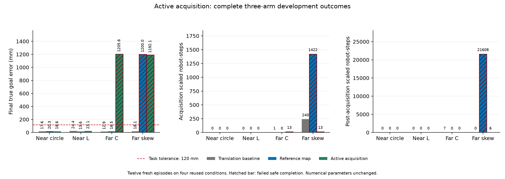

# 主动采集巡行：完整十二回合验证

**预定门槛 FAIL，候选未采用，默认关闭。** 原平移参照、参考地图、主动采集
三臂安全完成分别为 **4/4、3/4、2/4**，G500 均为 **2/4**。新候选四例都取得
有效初始参考，但两个远场均停在 CONTACT_READY，600 秒截尾。采集改善没有
形成完整搬运改善，全部失败保留。

本轮新增物理回合 **12**：四个复用开发条件×三臂，全部执行完成、执行错误0、
源码完整性PASS。八个旧臂回合的全部25组回放数组及配置、诊断、物理子步和
科学汇总字段精确复现。最佳数值参数、初态、物理模型、600秒预算、成功/硬安全/
G500判据均保持；没有按结果筛选形状或组合被否决的机制。

## 机制与原定门槛

默认关闭的 `initial_acquisition_circulation` 只在初始参考的 `acquiring` 阶段
改变名义运动：选择允许的局部地图中最近的边界点，按其法向作逆时针切向巡行，
并按已有增益修正法向间距。间距取既有 cage/lead 偏移和采集安全余量的最大值，
速度仍受原最大速度约束；没有新增或调优数值参数。

空视图沿用原搜索/召回；参考冻结或不可用后恢复原部署/搬运名义控制。每个指令
仍通过原安全QP。候选需要参考地图模式及其全部既有兼容防护，不读取真实物体
中心、形状、任务起点或全队地图。完整逐帧审计确认巡行仅发生在采集期，地图
投票均来自新鲜本机/一跳接受读数；缺测时名义速度归零。**名义零速度不保证
QP输出为零或联合约束可行。** 系统整体仍使用原共享阶段监督器。

预定门槛通过项：12例执行完成、8个旧臂精确复现、保留原圆形/L形G500通过。
失败项：4例安全完整完成、采集缩放为零、逐条件采集结束后缩放不增加。
四例有效零时刻、零错误HOLD、零原硬安全违规，不能抵消这些失败。

| 指标 | 原平移参照 | 参考地图 | 主动采集 |
| --- | ---: | ---: | ---: |
| 安全完整完成 | 4/4 | 3/4 | 2/4 |
| G500 | 2/4 | 2/4 | 2/4 |
| 有效初始零时刻 | 4/4 | 3/4 | 4/4 |
| 错误HOLD / 原硬安全违规 | 0 / 0 | 0 / 0 | 0 / 0 |
| 600秒预算截尾 | 0/4 | 1/4 | 2/4 |

## 全部十二回合

B=原平移参照，M=参考地图，A=主动采集。时间是实际终止时间，截尾不是完成。
缩放单位为机器人步，不是独立样本数；“采集结束后”也包括采集失败后的不可用期。

| 条件 | 臂 | 安全完成 / G500 | 终点误差 mm | 时间 s | 参考冻结 s | 采集/结束后缩放 |
| --- | --- | --- | ---: | ---: | ---: | ---: |
| 近场圆形 | B | 是 / 是 | 17.601 | 14.70 | 1.80 | 0 / 0 |
| 近场圆形 | M | 是 / 是 | 20.323 | 17.00 | 1.75 | 0 / 0 |
| 近场圆形 | A | 是 / 是 | 18.599 | 16.60 | 2.30 | 0 / 0 |
| 近场L形 | B | 是 / 是 | 24.398 | 17.65 | 1.70 | 0 / 0 |
| 近场L形 | M | 是 / 是 | 13.580 | 18.45 | 1.70 | 0 / 0 |
| 近场L形 | A | 是 / 是 | 23.115 | 13.25 | 2.00 | 0 / 0 |
| 远场C形 | B | 是 / 否 | 12.925 | 43.60 | 20.50 | 1 / 7 |
| 远场C形 | M | 是 / 否 | 16.482 | 45.20 | 20.45 | 0 / 0 |
| 远场C形 | A | 否 / 否 | 1205.599 | 600.00（截尾） | 18.70 | 13 / 0 |
| 远场斜箱 | B | 是 / 否 | 18.126 | 52.25 | 39.50 | 240 / 0 |
| 远场斜箱 | M | 否 / 否 | 1200.000 | 600.00（截尾） | 未冻结 | 1422 / 21608 |
| 远场斜箱 | A | 否 / 否 | 1192.117 | 600.00（截尾） | 20.40 | 13 / 6 |

图中斜线表示安全完成失败；精确值见上表及[十二回合CSV](all_twelve_episodes.csv)。
原始图表及其哈希保留，v2仅调整标签排版，见[图表修订来源](figure_revision_v2.json)。

## 改善与未解决的问题

**参考获取改善有直接证据。** 原地图候选的斜箱在60秒截止时只有3份合格采集，
没有冻结；本轮主动采集在20.4秒取得7份合格采集，C形在18.7秒取得5份。
四个新候选在冻结前的真实物体平移、旋转和接触采样均为0，零时刻有效。
斜箱采集缩放从地图臂1422降为13，但C形从0升为13；两例都没有达到原零缩放要求。
不得把缩放减少写成动态安全证书。

**参考冻结后没有形成持续协作激活。** C形在CONTACT_READY停留11,512帧，
激活0/1台的帧数为11,422/90，最多1台；斜箱停留11,468帧，激活0/1/2/3台
分别为10,655/777/33/3帧。两者都未达到原4台门槛，没有进入TRANSPORT、BRAKE
或HOLD。实际正接触计数最高分别为3和7，说明物理接触数量不能直接代替协作
激活数量；这些计数本身尚不足以确定失效原因。

旧地图C形在CONTACT_READY最多3台激活、后直接制动的结果仍保留；它在后续
BRAKE有过4台计数，不应被误写为“整个回合最多3台”。各阶段直方图和原阶段
响应完整存于[阶段与接触统计](phase_diagnostics.json)，没有修改阶段记录。

**联合约束问题仍在。** C/斜箱的最小屏障缩放系数分别为0.15234375和0.16796875，
斜箱冻结后还增加6次缩放。之前的[1992帧精确采集诊断](../acquisition_trace_v1/README.md)
已经排除容量耗尽，并显示物体/机器人约束分别可行而合并不可行。新巡行并未
自动解决这种相互限制，不能通过放宽半径、准入、截止或协作门槛绕过验收。

下一步先对这两条新失败轨迹作冻结前后精确重放：核对局部参考可用性、部署
目标、接触方向/有效推力、激活拒绝原因和邻居限制，分清“已有接触但不激活”
与“无法到达有效接触位置”。再预先冻结一项针对性机制，与原平移和当前失败
臂匹配比较，必须保留原四例完成、采集零缩放、后续缩放不增加及原G500通过。
这是下一步推断，不是已经验证的修复；本轮不追加调参或新候选物理回合。

之后仍需更广原成功保持、未使用条件验证、独立部署贡献对照和论文更新。
共享全队进度/阶段监督、真实旋转适用范围、动态安全与实机验证仍未解决。
当前四条件反复用于开发，不能报告为总体可靠率；最新远场几乎未搬动，较小
转角也不构成旋转鲁棒性证据。

## 身份与复核

[完整分析与全部门槛](analysis.json) · [冻结协议](protocol.json) ·
[执行收据](execution_outcome.json) · [工程检查](engineering_checks.json) ·
[原发布产品哈希](publication.json) · [最终独立审查](final_review.md)

物理源码SHA-256：`37f2e00017ce2e34ec932956174e7778f639c0732206e023fed74a34ef6dda1e`。
协议SHA-256：`0ca3f1369196fc882d884cf5583205d7671ab3749489f33a0dc116f140d9fdae`。
最佳公共配置SHA-256：`a5d5c8e200fa502557d4da9a9db2a646d027abababd59661bcdac21a1b43b112`。
核心回归912通过/2跳过，针对性47通过；冻结前八个旧评价结果已核验。

物理session44073、分析59625、发布86802均终结退出0。原始数据在
`runs/research/2026-11-03-acquisition-circulation-v1/run/`；执行前源码、帮助脚本、
设计和协议在同级`freeze/`；工程及命令日志在同名`runs/maintenance/`目录。
本地joblib1.5.1/PyYAML6.0.2与锁文件1.6.0/6.0.3的既有差异保留，不能标记为
锁环境物理复跑。历史结果与源码快照均未覆盖。
