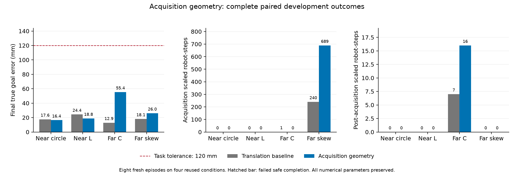

# 采集几何一致性：八回合完整结果

**结论：冻结推进门槛 FAIL，候选不采用、默认关闭。** 保持最佳数值参数，
单独调整采集期名义围拢目标后，四例安全完成仍为 4/4、错误 HOLD 和硬安全
失败均为 0，但远场屏障缩放明显增加，G500 仍为 2/4。

这项结果否定了“仅把采集目标移到安全距离外就能消除缩放”的充分性。
不能把已修正的几何构造契约称为动态安全问题已解决。

## 比较与预先约定

四个反复使用的开发条件，每条件两个新物理回合：上一轮平移组合
`translation_all_captured`，以及只打开 `initial_reference_safe_geometry`
的 `safe_geometry`。全部八回合的初态、seed 20261102、原数值参数、物理、
成功和安全门槛相同；每例最多 12000 步 / 600 秒，采集最多 60 秒。

新开关只在采集时将名义 cage/lead 距离下界对齐到活动安全半径加已有
feasibility margin，本配置为 0.195 + 0.033 = 0.228 m；保留更大的原偏移，
冻结后恢复原几何。没有降低安全半径、扩大采集期限或改变零时刻规则。
所有候选采集完成前真实接触、物体位移和转角均为零，零时刻有效。
采集的发生时间可以因轨迹改变而改变，不应误称冻结时刻数值相同。

执行前冻结了[设计](../../../experiments/ccta2027/acquisition_geometry_v1_design.md)、
[协议](protocol.json)、源码和环境。推进门槛除四例安全完成、无错误 HOLD、
零时刻有效及原 G500 通过保持外，还要求每例采集缩放为零、冻结后缩放不增加。
两个缩放条件未通过；原门槛未作事后修改。

## 全部结果

下表均为“平移参照 → 几何候选”。缩放单位为**机器人控制步**，不是独立事件
或独立样本。八例均安全完成，时间包含采集、搬运和收定。

| 条件 | 终点误差 mm | 总耗时 s | 采集期缩放 | 冻结后缩放 | G500 |
| --- | ---: | ---: | ---: | ---: | --- |
| 近场圆形 | 17.601 → 16.403 | 14.70 → 13.10 | 0 → 0 | 0 → 0 | 通过 → 通过 |
| 近场 L 形 | 24.398 → 18.836 | 17.65 → 17.50 | 0 → 0 | 0 → 0 | 通过 → 通过 |
| 远场 C 形 | 12.925 → 55.369 | 43.60 → 56.90 | 1 → 0 | 7 → 16 | 失败 → 失败 |
| 远场斜箱 | 18.126 → 26.044 | 52.25 → 80.55 | 240 → 689 | 0 → 0 | 失败 → 失败 |

[全部八回合 CSV](all_eight_episodes.csv) · [完整分析及逐帧缩放索引](analysis.json) ·
[执行收据](execution_outcome.json) · [图表及产品哈希](publication.json)

四个新参照回合均精确复现上一轮平移候选：每例全部 25 个 replay 数组、
科学 JSON 字段相同。比较只忽略 Git 提交来源、cohort 等执行元数据及机器耗时。
新八例没有预算截尾、执行错误、硬安全失败或错误 HOLD。

## 退化定位与解释边界

- 斜箱的 689 次缩放分布于 328 个控制帧，全部在采集期：DISCOVER 92 次、
  ENCLOSE 597 次；最小缩放因子为 **0**。采集耗时从 39.50 增至 55.75 秒。
  它并未因名义目标向外调整而消除约束退化。
- C 形的采集缩放从 1 降为 0，但冻结后从 7 增为 16。新 16 次全部发生于
  BRAKE，涉及 agent_05、控制帧 914–933；旧 7 次发生于 CONTACT_READY。
  新最小缩放因子 0.4453125，旧全程最小值 0.15234375；次数与严重度应分开报告。
- C 形终点误差与耗时均退化，最大真实转角由 2.574° 增至 3.575°。
  平移模型的零拟合转角仍只是建模假设，不能视为真实无旋转或配准证书。
- 新几何改变了轨迹和采集模板，故不同回合的反馈 MAE 使用各自轨迹和可用帧；
  不能冒充相同输入上的逐帧误差对照。全部分母保存在 CSV/分析中。
- “硬安全失败 0”按原独立检查的间距容差、穿透预算和求解失败定义计算，
  不等价于原屏障完整成立；G500 仍明确失败。没有按形状挑选某一臂拼接结果。

## 下一步

保留已有平移组合为研究参照，几何候选不进入扩大验证。
先从两臂的首个缩放帧和最严重帧复原安全 QP，分开检查边界法向/速度估计、
机器人间约束及速度限幅是否互斥。名义目标的一致性与真实联合约束可行性要
分别判断，不能继续盲目放大距离，也不能放宽 G500 或安全约束获得通过。

此后仍需原成功保持和未用条件验证、公共控制链下的边界部署独立对照，以及
论文主张与最新证据统一。四个开发条件不支持总体可靠性或部署优越性结论。
全队反馈/共享阶段监督、较大旋转与实机验证、锁环境物理复现仍未完成。

## 工程与运行身份

根 `.venv` 完整回归 **892 通过、2 跳过**；针对性检查 37 通过。
实现前失败、首轮测试信息匹配错误及最终通过日志均保留。
[工程核验](engineering_checks.json)与[执行记录](../../../experiments/ccta2027/acquisition_geometry_v1_plan.md)
给出具体身份；图表已目视检查。

最佳配置 SHA-256 仍为 `a5d5c8e200fa502557d4da9a9db2a646d027abababd59661bcdac21a1b43b112`。
本轮运行源码指纹为 `b602d6d64413d897f95e0a2b58914159f9eb97c1c2f6870431aaed3479b5511d`，
协议 SHA-256 为 `38efea5ce15a12b38ef8b706fc0f17db7ce9ef8771e6ae8c4edd6a60de6cc399`。
原始数据和冻结源码位于 `runs/research/2026-11-03-acquisition-geometry-v1/`，
工程日志位于 `runs/maintenance/2026-11-03-acquisition-geometry-v1/`。
本地 joblib/PyYAML 与锁文件的既有差异未改变；不能将本次数据重标为锁环境验证。
