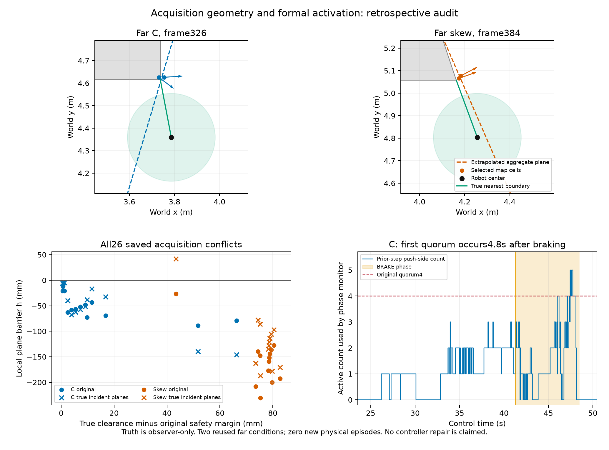

# 采集边界外推与 C 形正式激活诊断

2026-11-03，基于[观测恢复八回合](../reference_reacquisition_physical_v1/README.md)的保存轨迹，精确重放远场 C 形和斜箱 **375 + 409 = 784 帧**，保留全部 **26 次采集期缩放**；另有 20 帧工程预检。四个候选的阶段监督器另行重建 **2,589 帧**。**新增物理回合为 0，没有修改控制器、最佳数值参数或验收门槛，也没有宣称修复成功。**

结论：这些状态中的负局部屏障主要指向有限边界被外推为无限支持平面；单独改善法向不足以消除该几何问题。C 形没有漏掉一次已满足人数门槛的 TRANSPORT 转换：首次达到原 4 台门槛发生在开始制动 **4.8 秒之后**，需要改善制动前的协作激活。

| 核验指标 | 远场 C 形 | 远场斜箱 |
| --- | ---: | ---: |
| 精确控制器重放帧数 | 375 | 409 |
| 全部采集期缩放机器人步 | 13 | 13 |
| 被选中地图单元数（去重） | 9 | 4 |
| 法向融合重建检查数 | 1,326 | 483 |
| 最大法向重建残差 | 5.55e-16 | 4.44e-16 |
| 重建来源扫描 / 回波数 | 794 / 2,437 | 30 / 40 |
| 真实距离超过原采集安全边距 | 13/13 | 13/13 |
| 原聚合屏障 h 为负 | 13/13 | 13/13 |
| 改用对应真实边的无限平面后 h 仍为负 | 13/13 | 12/13 |

每帧原指令、完整控制诊断、求解器统计、阶段守卫/响应及保存地图点均精确一致。采集期事件全部属于 agent_05。来源追踪重建原传感器随机输入、PCA 邻域、法向与置信度，再按实际更新顺序重建地图融合；1e-10 仅为浮点重建检查容差，不是安全门槛。这些帧、扫描与回波来自两个反复使用的条件，彼此相关，不能当作独立可靠性样本。

## 几何证据与适用范围

全部 26 个事件的每个被选地图单元，其对应最近真实边上的机器人正交投影都在边段端点之外。地图单元按最近真实边关联，这是观察者的诊断关联，不是材料点身份认证。原采集安全边距为 0.195 m。

| 首个事件 | 保存帧（从 1 开始） | 真实距离减安全边距 | 原聚合 h | 真实边无限平面的聚合 h |
| --- | ---: | ---: | ---: | ---: |
| C 形 | 326 | +66.303 mm | −79.234 mm | −146.048 mm |
| 斜箱 | 384 | +75.330 mm | −230.809 mm | −186.689 mm |

C 形首个事件的两个地图法向与最近真实边夹角为 36.721° / 3.583°；斜箱为 0.950° / 9.241°。把所选单元换成对应真实边的位置与法向、保留原聚合权重后，仍有 25/26 个负 h。斜箱第 408 帧为反例，修正后 h 为正，完整保留。这一反事实**只重算几何 h**，没有重新求解这 26 个反事实 QP，也没有运行新闭环；不能据此声称 25 个修正 QP 仍不可行或仍会缩放。

[此前两个独立求解器见证](../circulation_conflict_witness_v1/README.md)说明两个选定旧状态的联合约束矛盾不因取消速度上限而消失。本次扩大了几何来源追踪范围，不能把两个独立求解器结论扩展成全部 26 个反事实状态的求解结果。

上方灰色为真实物体，圆为原采集安全边距，箭头为所选地图法向；真实轮廓和距离仅供观察者分析，没有提供给控制器。下左图展示全部 26 个事件，下右图展示 C 形阶段计数。
[PDF 图](geometry_and_activation.pdf) · [全部 26 个事件 CSV](all_26_conflicts.csv) · [完整几何分析与首事件来源摘要](analysis.json)

## C 形为什么没有正式进入 TRANSPORT

原阶段监督器用**上一步 push_side 几何标志的数量**作为 transport_active；这是原算法的阶段输入，不是独立真实接触数。本次核验了四条轨迹中每步输入与上一步诊断的一致性，并用原 PhaseMonitor 重建全部响应。

- C 形在 CONTACT_READY 更新时没有一次达到 4 台门槛；记录为该阶段的最大计数为 3。
- 保存帧 826（监督器帧 825），41.25 s，按原 `estimated_stop_from_contact_ready` 进入 BRAKE；此时 active=1，估计进度 0.780005796 m、目标 1.2 m、剩余约 0.419994 m，原制动提前量为 0.42 m。
- 首次达到 4 台在保存帧 922、46.05 s，已处于 BRAKE；阶段最大计数 5 也只在 BRAKE。旧汇总最大值 5 不能证明制动前已具备正式激活条件。

近场 L、斜箱、近场圆形首次达到门槛的时刻分别为 5.45 / 43.15 / 5.55 s，均在该步进入 TRANSPORT。[四例阶段表](phase_summary.csv)和[完整阶段证据](phases.json)保留原字段：CSV 的 `formal_transport_frame` / `brake_frame` 是从 **0** 开始的监督器帧，`first_quorum_frame` 是从 **1** 开始的保存帧；控制时间为 `(保存帧−1)×0.05 s`。`by_phase` 按更新后的阶段分组，进入 CONTACT_READY 更新的判定次数另行统计。

## 下一步与验收

下一项应设计仅使用本机及一跳观测的有限边界支持规则，明确观测误差、端点外区域及未知边界延伸的处理，同时保留缺失物体运动时的保守速度界。不能把真实多边形交给控制器，也不能直接把未观测区域当作自由空间；有限观测边段本身不是未知物体安全证书。先对保存冲突状态检验约束和不确定性处理，再另行冻结新物理试验。

保持最佳数值参数、原 4 台门槛及原安全/完成判据，要求四个开发条件保持安全完成与原通过项、采集期缩放为零、冻结后缩放不增加，并单独检查 C 形制动前的正式协作激活。斜箱 6 次冻结后缩放仍未由本次采集诊断解释。通过完整链验收后，才继续更广原成功保持、未使用条件验证、部署方法匹配对照和论文更新。

## 身份、复现与原始数据

- [发布前完整性核验](verification.json)：7 份文档、293 个本地链接通过，全部新产品哈希、26 行事件表、四例阶段表、原物理研究产品及运行源码/环境身份一致。核验收据记录当时的文档范围；它不是新的物理试验或完整核心回归。
- [冻结诊断设计](../../../experiments/ccta2027/acquisition_normal_audit_v1_design.md)及[执行记录](../../../experiments/ccta2027/acquisition_normal_audit_v1_plan.md)。设计中的原始待办保持冻结，完成状态在执行记录中更新。
- [精确追踪](../../../scripts/trace_acquisition_normals.py)、[来源与几何分析](../../../scripts/analyze_acquisition_normals.py)、[阶段重建](../../../scripts/audit_reacquisition_phases.py)、[发布脚本](../../../scripts/publish_acquisition_normal_audit.py)。
- [发布产品哈希](publication.json)区分 784 帧完整重放、20 帧预检和 2,589 帧阶段重建；`analysis.json` 中 `new_controller_replay_frames=0` 只指后续来源分析阶段没有再次重放。

来源物理协议 SHA-256：`b4c04255521da8a72345422e0a65c150c8438abc26c5c55104767b0198b26f0b`；冻结运行源码：`5251bea3bc76971a74f62fc2c7899a33cca52cd57a267cd1feebcd033d8e0eb6`；最佳配置：`a5d5c8e200fa502557d4da9a9db2a646d027abababd59661bcdac21a1b43b112`。

大体积逐帧地图、全部来源系数、原 QP、脚本/设计快照和收据保存在本地 `runs/research/2026-11-03-acquisition-normal-audit-v1/`，执行日志在同名 maintenance 目录。不覆盖旧八回合及历史失败。根 `.venv` 的 Python 为 3.12.14，joblib/PyYAML 为 1.5.1/6.0.2，与锁文件 1.6.0/6.0.3 的差异未改变；本轮不是锁环境重跑。
