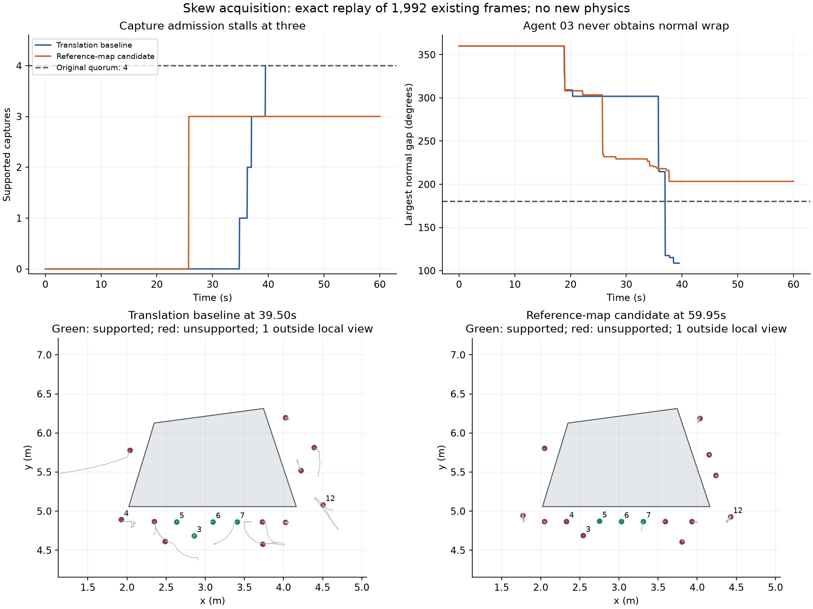

# 斜箱采集失败：完整前缀追踪

**1,992 个已有控制帧精确复现，新增物理回合 0。** 原平移参照重放到第791帧
（39.5秒冻结）；参考地图候选重放到第1201帧（60秒截止）。所有控制输出、
诊断、求解器累计量、阶段/门槛/响应及记录地图逐帧一致。

| 指标 | 原平移参照 | 参考地图候选 |
| --- | ---: | ---: |
| 最多通过原采集准入的机器人 | 4 | 3 |
| 最早支持帧 | 05:698；06:726；03:741；07:791 | 05/06/07均516 |
| 最大采集格子数 / 原容量 | 783 / 4096 | 818 / 4096 |
| 因容量丢弃的新格子 | 0 | 0 |
| 采集期间约束缩放 | 240 | 1422 |
| 截止后首帧约束缩放 | 未包含 | 4 |
| 物体真实平移 / 旋转 | 0 / 0 | 0 / 0 |

**容量耗尽假说被否定。** 两臂各有15台取得足够数量、条件数和空间跨度的采集点；
候选其中12台最终仍不满足“最大法向间隙小于180°”，只有3台通过全部准入条件。
agent15始终没有采集点。地图覆盖率较高不代表这些法向覆盖条件成立。

候选agent03到第1200帧的最大法向间隙仍为203.376°，名义速度模长约0.738m/s，
滤后速度只有0.000128m/s；它仍在执行既有的直线再部署目标，同时两条邻居约束活跃。
agent05的滤后速度约1.55e-9m/s。沿同一近侧边界追逐目标未取得第4份合格参考。
这是采集目标、路径和邻域约束的共同停滞证据；不能仅降低准入门槛来宣称修复。

图下方显示最后约10秒轨迹与局部几何，1台机器人在局部视窗外；完整16台的
支持指标均保留在[采集表](capture_support.csv)。几何真值只供离线观察。

全部240/1426个缩放事件中，去掉鲁棒裕量后，机器人/墙约束与物体约束各自可行，
组合均不可行。再将估计物体运动置零，原参照只有66个恢复可行，候选只有截止后
首帧的2个恢复可行；候选采集期1422个仍全部冲突。单纯修正速度不能解决这批事件。

两臂首次和最低缩放各取一个见证，共4个，由CLARABEL独立核验五组约束，结果全一致。
3个见证即使取消速度上限仍无可行解；候选首次见证的最小可行速度为0.490806m/s，
超过原0.35m/s。此分析没有修改实际约束、取消速度上限或向控制器提供真值；
也没有证明全队联合优化必然可行。

下一项机制假设：将采集阶段的目标改为带既有非接触间距的同向边界巡行，主动
补充观测方向并避开相向的直线再部署。只用本机/一跳地图及已有参数，原QP和
采集准入保持；冻结后恢复原搬运路径。它需要独立设计与新物理验证，目前没有采用。

[完整分析及4个独立见证](analysis.json) · [逐帧支持/速度/缩放](support_timeline.csv) ·
[设计](../../../experiments/ccta2027/acquisition_trace_v1_design.md) · [产品哈希](publication.json)

原运行源码保持`dc9e9ac1d5360f54c4bc7b85d1066c8ec01b1baa8955d90c181385857b918f37`。
原始追踪和帮助脚本快照在`runs/research/2026-11-03-acquisition-trace-v1/`。
两个20帧预检、原791帧和候选1201帧均正常结束；预检不计入1,992个完整前缀帧。
既有八回合FAIL、保护参数和此前发布证据均未改写。
