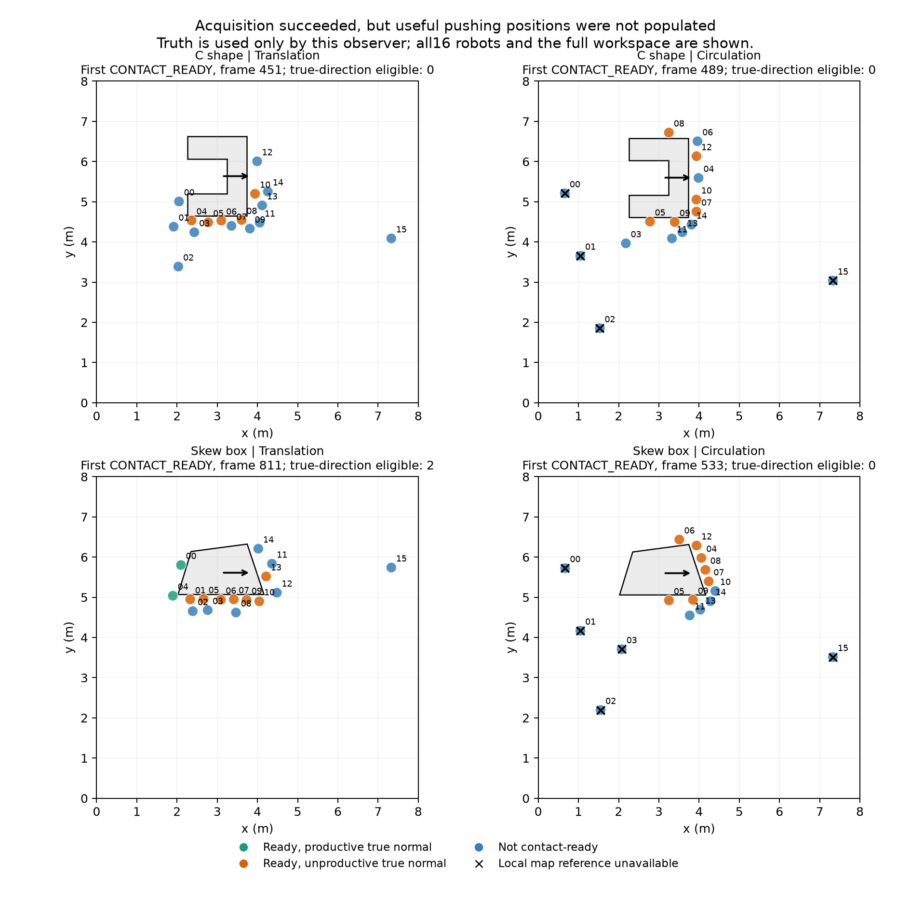

# 参考冻结后的接触激活诊断

2026-11-03：完成对原主动采集十二回合的保存记录审计，以及四条控制器轨迹的精确重放。**新增物理回合为 0。** 两个远场候选停留在 CONTACT_READY 的证据同时指向接触位置分配和缺测后的观测恢复权限；没有据此宣称搬运已修复。

## 验证范围

- 全十二回合核验 **279,908 次最终模式为 cage/push 的调用**，重建的推力准入谓词与记录逐项一致，阶段监督的激活数与前一帧推力标记一致。提前返回和参考不可用覆盖另行统计，不将它们混作已调用搬运分支。
- 原平移参照 C 形 / 斜箱完整重放 **872 / 1,045 帧**；主动采集候选分别重放至 **1,200 / 1,200 帧**，合计 **4,317 帧**。逐帧命令、诊断、阶段监督、求解器统计和保存地图精确一致。
- 候选的 1,200 帧对应 60 秒前缀，不是全部 600 秒的控制器重建。完整保存记录统计和前缀重放分别报告；这些开发条件没有增加独立样本。

## 关键结果

下表仅统计各自重放前缀中的 CONTACT_READY 阶段。除“帧数”外，计数单位均为机器人步；“真实方向合格”只检验原任务方向与真实最近边界法向的原阈值，不代表实际推力、完整准入或任务成功。

| 条件与方法 | 阶段帧数 | 已就位且有导航 | 观测方向合格 | 真实任务方向合格 | 非零名义指令被缺参考覆盖为零 |
| --- | ---: | ---: | ---: | ---: | ---: |
| C 形，原平移参照 | 262 | 1,488 | 393 | 387 | 0 |
| C 形，主动采集 | 712 | 4,634 | 26 | **0** | **2,848** |
| 斜箱，原平移参照 | 100 | 905 | 245 | 241 | 0 |
| 斜箱，主动采集 | 668 | 5,077 | 14 | **0** | **2,703** |

主动采集的两个前缀分别有 **4,608 / 5,063** 个机器人步同时不满足观测方向与真实方向要求，且因为已经进入接触带而禁止重新部署。几何就位不等于能够沿任务方向推动；参考成功冻结也不保证机器人已分布到有效接触位置。

另一个可分离问题是：缺少局部位移参考时，旧控制器将所有名义运动统一置零。C 形被抑制的原分支为 search 1,931、approach 712、recall 205；斜箱为 search 1,825、approach 627、recall 251。这样的机器人无法通过原搜索或接近动作恢复观测。

在两例第 1,200 帧各选四台缺参考机器人，共 **8 个条件运动见证**：保留原安全约束矩阵、右端项和速度上限，仅把被覆盖前的原名义指令交给原 QP，全部得到非零可行指令，独立 **CLARABEL** 解一致。这证明这些具体状态下的零运动来自权限覆盖；**不能证明后续路径安全、重新获取参考或完整搬运成功**。其他状态的安全约束仍可能不可行。

图为四条轨迹各自首次进入 CONTACT_READY 的快照，保留全部 16 台机器人和完整工作空间。真实几何仅用于独立观察者。C 形原平移参照在该首帧也没有方向合格机器人，但后续前缀累计出现 387 个；不能用首帧图替代上表的时间统计。

## 实现与后续验证

依据上述见证，另行实现了[默认关闭的观测恢复候选](../reference_reacquisition_v1/README.md)：仅在初始参考有效冻结后、TRANSPORT 之前，对无按压力的 search/recall/approach 保留原名义指令，继续通过原安全 QP。接触分工和联合约束问题仍待处理。

用户本次要求先发布成果与 README，因此本发布点保留诊断和工程实现，拟议八回合闭环比较仍为待执行设计。既有主动采集结果仍是安全完成 **2/4**、两个远场 600 秒截尾，原门槛 **FAIL**；本诊断不会改写该结论。

## 证据与复核

[分析与八个完整约束见证](analysis.json) · [前缀计数 CSV](prefix_counts.csv) · [十二回合保存谓词](saved_predicates.json) · [预定重放范围](replay_plan.json) · [精确重放收据](replay_outcomes.json) · [原产品哈希](publication.json) · [图表 PDF](contact_positions.pdf)

原冻结运行源码 SHA-256 为 `37f2e00017ce2e34ec932956174e7778f639c0732206e023fed74a34ef6dda1e`，原协议 SHA-256 为 `0ca3f1369196fc882d884cf5583205d7671ab3749489f33a0dc116f140d9fdae`。新候选代码没有参与上述旧控制器重放。完整逐帧记录、失败预检、脚本及设计快照保存在本地 `runs/research/2026-11-03-contact-activation-v1/`，执行日志在同名 `runs/maintenance/` 目录，详见[数据索引](../../DATA_INDEX.md)。

[诊断设计](../../../experiments/ccta2027/contact_activation_v1_design.md) · [实施记录](../../../experiments/ccta2027/contact_activation_v1_plan.md) · [保存记录审计脚本](../../../scripts/audit_contact_activation.py) · [精确重放脚本](../../../scripts/trace_contact_activation.py) · [独立分析脚本](../../../scripts/analyze_contact_activation.py)
