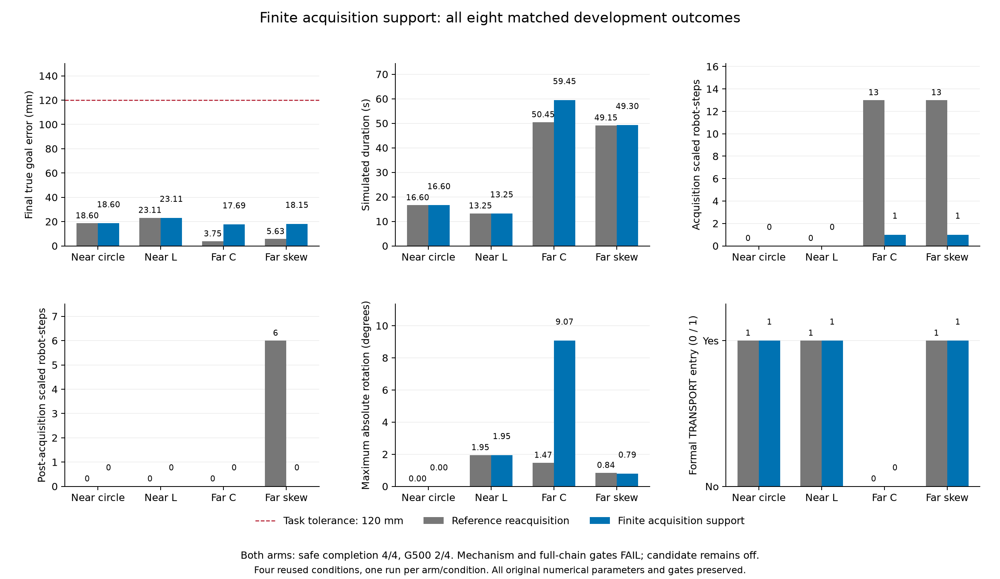

# 有限观测支持：完整八回合配对试验

2026-11-03。本轮保持全部最佳数值参数，验证采集期有限弦段及孤立回波保护约束。
四个复用开发条件、两臂、**8 个新物理回合**全部执行完成，安全完成均 **4/4**，
错误 HOLD、原硬安全违规和600秒预算截尾均 **0**。四个原对照的25组回放数组及
科学字段全部精确复现。**机制门槛 FAIL、完整链门槛 FAIL，候选未采用、默认关闭。**

C形和斜箱的采集缩放均从13次降为1次；斜箱冻结后的6次缩放降为0。
但C形仍未进入正式TRANSPORT，G500仍2/4；C形最大真实转角从1.471°增至9.072°，
耗时增加9秒、终点误差也增加。改善约束可行性并不代表完整搬运链已修复。

## 固定设计与实现边界

- [物理设计](../../../experiments/ccta2027/finite_acquisition_support_physical_v1_design.md)
  和[冻结协议](../../../experiments/ccta2027/finite_acquisition_support_v1.json)
  在执行前保存。每回合最多12,000步、dt=0.05s；停止确认40帧/0.005m/s，原任务容差0.12m。
  不追加重跑、形状专用参数或预算。
- 对照是既有 `reference_reacquisition`；候选只增加
  `acquisition_finite_support=True`。原控制、物理、初态、噪声、安全半径、四台激活门槛、
  制动和G500判据不变。[最佳配置](../../../configs/research/best_known_transport_v1.yaml)
  SHA-256仍为 `a5d5c8e200fa502557d4da9a9db2a646d027abababd59661bcdac21a1b43b112`。
- 输入仅为当前自身/一跳邻居回波的点、射线编号、物体标签及来源/时间戳，不读取真实边界或姿态。
  相邻有效射线构成有限弦段；不能并入弦段的近处回波保留为独立径向点保护，不跨缺测射线拟合直线。
  缺失覆盖或间距超过原上限时保留原物体约束。
- 仅在 `initial_reference_status == acquiring` 且地图为 `stationary_acquisition` 时启用；
  冻结当帧恢复原约束，因为该帧安全半径已恢复到搬运值。原静止采集假设对应速度界0；
  一旦法向旋转，标量运动界仍按所有径向法向处理。
- 距离保护为 `h = 有限几何距离 - 实测半间距 - 原采集安全半径`；
  原采集半径已包含3σ观测裕量，不重复计入。**实测半间距不能界定任意未知边界延伸，
  本候选是经验机制，不是任意未知形状或旋转情形的安全证书。**

## 全部结果

缩放计数单位为机器人控制步；“采集/冻结后”按原初始参考状态划分。
原硬安全检查包括机器人间距、进入物体、穿透预算和求解失败，**不把约束缩放等同于碰撞**。
G500另外要求原正式激活和零缩放等条件，不能用终点误差替代。

| 条件 | 方法 | 安全完成 | 终点误差 mm | 时间 s | 采集/冻结后缩放 | 正式TRANSPORT | G500 | 最大转角 ° |
| --- | --- | --- | ---: | ---: | ---: | --- | --- | ---: |
| 近场圆 | 观测恢复 | 是 | 18.599 | 16.60 | 0 / 0 | 是 | PASS | 0.000 |
| 近场圆 | 有限支持 | 是 | 18.599 | 16.60 | 0 / 0 | 是 | PASS | 0.000 |
| 近场L | 观测恢复 | 是 | 23.115 | 13.25 | 0 / 0 | 是 | PASS | 1.947 |
| 近场L | 有限支持 | 是 | 23.115 | 13.25 | 0 / 0 | 是 | PASS | 1.947 |
| 远场C | 观测恢复 | 是 | 3.748 | 50.45 | 13 / 0 | 否 | FAIL | 1.471 |
| 远场C | 有限支持 | 是 | 17.690 | 59.45 | 1 / 0 | 否 | FAIL | 9.072 |
| 远场斜箱 | 观测恢复 | 是 | 5.634 | 49.15 | 13 / 6 | 是 | FAIL | 0.843 |
| 远场斜箱 | 有限支持 | 是 | 18.149 | 49.30 | 1 / 0 | 是 | FAIL | 0.792 |

[完整八行CSV](all_eight_episodes.csv) · [完整分析及原对照复现](analysis.json)
· [PDF图](paired_outcomes.pdf) · [发布身份和哈希](publication.json)

四个候选的初始零位移参考均有效，冻结前真实平移、转角和接触样本均为0。
门槛逐项保留：执行完整、四个原对照精确、四候选安全完成、冻结后缩放不增加、原G500成功保持均通过；
**采集缩放清零失败**，所以机制门槛FAIL。完整门槛另外要求全部原G500通过及正式TRANSPORT，二者亦失败。
两臂各4例，均为已使用开发条件；不进行总体可靠率或统计显著性推断。

## 支持覆盖与两个残余事件

| 候选条件 | 使用有限支持的机器人步 | 原约束机器人步（含非采集阶段） | 孤立点保护行累计 | 可达性截断行累计 |
| --- | ---: | ---: | ---: | ---: |
| 近场圆 | 131 | 5,181 | 606 | 0 |
| 近场L | 193 | 4,047 | 627 | 0 |
| 远场C | 842 | 18,182 | 5,465 | 0 |
| 远场斜箱 | 606 | 15,170 | 3,655 | 0 |

全部应用步核验当前时间戳、实际一跳范围、自身回波、正物体约束行数、零未覆盖近处回波和冻结边界。
缺自身回波、间距未知/过大、超出适用距离和非采集阶段均保留原约束，各原因计数在完整分析中。
可达性截断与联合约束缩放分别记账；本轮有限支持行的前者为0，后者仍有2步。

[两个残余事件](residual_scalings.json)均为agent_05：C形保存帧365（步前18.20s）、
斜箱保存帧399（19.90s）。两者均已应用有限支持、未触发可达性截断；
因此不能将残余缩放简单归为旧平面回退。原科学收据仍记录缩放，最小系数分别为0.933594/0.777344。
该提取只读取本次保存诊断，不包含反事实QP或新增物理样本，具体联合冲突仍待核验。

## 前置同状态筛选，单独记账

三个事后筛选都使用此前26个采集冲突状态，**新增物理回合均为0**。
原件及各版本的脚本、几何模块、设计和哈希保留在各自目录，不将旧v1重标为v2。
[筛选汇总与全部身份](preliminary_probes.json)保留两种运动界、两种rho和覆盖分母。

| 固定筛选 | 支持情况 | 原rho、速度界0的可行数 | 原rho、速度界0.2的可行数 | 独立QP对照 |
| --- | --- | ---: | ---: | ---: |
| 自身扫描聚合 | 2/26无支持 | 24/26 | 16/26 | 三替代方法合计312 |
| 自身既有局部线段 | 4/26无支持 | 13/26 | 11/26 | 同上 |
| 一跳既有局部线段 | 0/26无支持，但近处回波完整覆盖仅16/26 | 17/26 | 15/26 | 同上 |
| 仅相邻射线弦段v1 | 0/26准入，均有未覆盖近回波 | 0/26准入后可行 | 0/26准入后可行 | 0次；没有实际求解 |
| 弦段+孤立点保护v2 | 两种速度界均26/26准入 | 18/26 | 15/26 | 104 |

前三种估计分别在12、4、3个状态高估真实距离，因此“可行”不能直接作为安全依据。
v2在两种速度界各26个状态均未见距离高估，但不能据此证明任意未知边界安全。
v1没有可评价距离，不能把分母0写成“零高估的成功”。v2仍有8个静止状态不可行；
执行物理比较是为了检验前段路径改变的影响，不是在旧状态上宣称已全面解决。
既有线段拟合与新弦段的误差预算定义不同，上表不是仅改变一个几何因素的因果消融。

## 工程验证、身份及后续工作

[工程收据](engineering_checks.json)：冻结源码的核心回归 **987通过、2跳过**。
覆盖缺失/过期/跨来源回波、孤立点和零距离法向、标量运动界、缺覆盖回退、关闭等价、
局部邻域、冻结当帧半径切换及评价门槛。所有首次失败、修复和完整测试原日志保留。
后续Git提交或CI不改变本次物理运行身份。

- 运行提交：`5e2a53651893d57aecd71879f35be7449f9ad8d8`。
- 物理源码SHA-256：`dab8a22ad7f9ef2e488e09ff2a5a2c8923ac53a2ff2af2f5e820a8341475be97`。
- 协议SHA-256：`c50140a639f488add5424cc93db491bcea30f15d2a09c0eb74ad6500e8e5d54a`。
- 原始数据：`runs/research/2026-11-03-finite-acquisition-support-v1/run/`，同级`freeze/`保留执行前快照。
  工程日志：`runs/maintenance/2026-11-03-finite-acquisition-support-v1/`。
- 当前根`.venv`为Python3.12.14；joblib/PyYAML 1.5.1/6.0.2与锁文件1.6.0/6.0.3不同。
  原环境保留，本次不能称作锁环境物理复跑。

下一步先在两个残余状态精确重建联合QP，区分物体支持、邻域约束、rho和速度限制的贡献；
同时分析C形制动前的协作分工和9.072°旋转，保留原四台门槛及制动判据。
公共链通过完整四条件验收后，才冻结更广原成功保持、未使用条件验证与部署方法匹配对照。
已有部署审计只支持覆盖改善，完成数均11/12；本轮公共安全约束改善不能归作CVT独立优势。
论文、完全分布式阶段协同和实机验证仍未完成。
