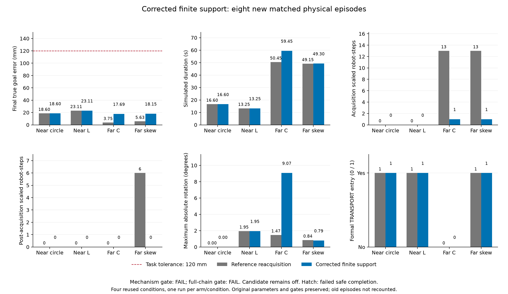

# 修正后有限支持：新八回合物理验证与完整采集重放

2026-11-03。已为孤立回波筛选修正版完成**8个新物理回合**，填补此前只有工程回归、
没有修后闭环验证的缺口。两臂均安全完成 **4/4**，错误HOLD、原硬安全违规、600秒截尾均 **0**；
G500均 **2/4**。**机制门槛FAIL、完整链门槛FAIL，候选未采用、默认关闭。**

修正版的四条候选轨迹与修正前的25组回放数组及物理子步记录全部一致，主要任务指标没有变化；
`paired_metrics.json`中的约束诊断发生变化，不能声称所有科学记录都相同。
修复了一个可复现的约束遗漏缺陷，并未解决两个残余缩放步、C形未正式TRANSPORT及旋转增大的问题。

## 固定设计与八个新回合

[独立物理设计](../../../experiments/ccta2027/finite_acquisition_support_physical_v2_design.md)
和[冻结协议](../../../experiments/ccta2027/finite_acquisition_support_v2.json)在执行前保存。
四个原观测恢复对照加四个修后有限支持候选；既有初态、种子、全部最佳数值参数、物理模型、
四台激活门槛、制动规则、安全半径、rho、G500及0.12m任务容差保持。
每回合最多12,000步、dt0.05s、600s；原40帧/0.005m/s收定规则，未额外重跑或增加预算。

| 条件 | 方法 | 安全完成 | 终点误差 mm | 时间 s | 采集/冻结后缩放 | 正式TRANSPORT | G500 | 最大真实转角 ° |
| --- | --- | --- | ---: | ---: | ---: | --- | --- | ---: |
| 近场圆 | 观测恢复 | 是 | 18.599 | 16.60 | 0 / 0 | 是 | PASS | 0.000 |
| 近场圆 | 修后有限支持 | 是 | 18.599 | 16.60 | 0 / 0 | 是 | PASS | 0.000 |
| 近场L | 观测恢复 | 是 | 23.115 | 13.25 | 0 / 0 | 是 | PASS | 1.947 |
| 近场L | 修后有限支持 | 是 | 23.115 | 13.25 | 0 / 0 | 是 | PASS | 1.947 |
| 远场C | 观测恢复 | 是 | 3.748 | 50.45 | 13 / 0 | 否 | FAIL | 1.471 |
| 远场C | 修后有限支持 | 是 | 17.690 | 59.45 | 1 / 0 | 否 | FAIL | 9.072 |
| 远场斜箱 | 观测恢复 | 是 | 5.634 | 49.15 | 13 / 6 | 是 | FAIL | 0.843 |
| 远场斜箱 | 修后有限支持 | 是 | 18.149 | 49.30 | 1 / 0 | 是 | FAIL | 0.792 |

[全部八行CSV](all_eight_episodes.csv) · [完整分析与四个原对照复现](analysis.json)
· [对修正前候选的比较](historical_candidate_comparison.csv)
· [逐数组及科学字段核验](historical_candidate_reproduction.json)

[PDF图](paired_outcomes.pdf)。四个对照的25组回放数组和全部科学字段精确复现。
四个修后候选与旧候选的配置、物理子步、汇总及科学结果字段一致，逐步诊断文件不一致。
旧候选是历史比较对象，不计入本次8个新回合分母。四个候选的初始零位移参考均有效，
冻结前真实运动和接触样本均为0。有限支持的可达性截断行均为0；联合约束缩放仍为两个机器人步。

机制门槛仅“候选采集缩放为零”未通过；完整门槛中的“全部G500通过”和“全部正式TRANSPORT”亦未通过。
原硬安全检查与约束缩放单独报告，缩放不是碰撞的同义词。四个条件反复用于开发，不能据4/4推断总体可靠率。

## 修正前完整采集前缀的同状态诊断

[事后诊断设计](../../../experiments/ccta2027/finite_support_review_validation_v1_design.md)独立于物理试验。
原冻结控制器按保存的步前位置、物体姿态、前一步指令和时间戳重放，逐帧核验全部指令、诊断、
求解器统计、阶段和地图点。修正后的几何只作为观察器计算，结果没有反馈给重放控制器，没有积分物理。

| 条件 | 精确帧数（含冻结帧） | 全部滤波调用 | 提供有限支持包的调用 | 原准入 | 修后准入 | 几何/准入发生变化 |
| --- | ---: | ---: | ---: | ---: | ---: | ---: |
| 近场圆 | 47 | 752 | 568 | 131 | 131 | 35 |
| 近场L | 41 | 656 | 507 | 193 | 183 | 64 |
| 远场C | 377 | 6,032 | 1,281 | 842 | 838 | 441 |
| 远场斜箱 | 409 | 6,544 | 1,120 | 606 | 586 | 286 |
| 合计 | **874** | **13,984** | **3,476** | **1,772** | **1,738** | **826** |

另有C和近场L各20帧预检，共40帧，不计入874帧或新物理回合。未知/过大间距需回退原约束，
不能将这些状态计作成功删除物体约束。准入净减34步：37步由准入变为回退，3步由回退变为准入。

[完整诊断汇总](saved_state_audit.json)保留全部分母、准入转移和回退原因。
[七个确定性选择的见证](audit_witnesses.json)包含两个原残余事件、每条件首个改变的准入几何和首个旧指令违反修后行的状态；
14次原2D求解器/CLARABEL可行性比较全部一致。

两项残余事件仍为C保存帧365、斜箱399的agent_05，均在修后几何下去掉rho仍不可行。
另外C帧355/363的旧指令违反全rho行，但原记录已经是`relaxed_margin`，去rho后可行；
不能将四项全rho残差自动归因于新增约束或说成新发现的四个安全事故。
这些是同状态约束诊断；上述新物理试验才评价修正版的闭环表现。

## 支持使用量与原CSV的更正衍生表

修后候选使用有限支持的机器人步分别为圆131、L183、C838、斜箱586；
原路径步数分别5,181/4,057/18,186/15,190。孤立点保护行累计分别650/668/6,096/3,980，
可达性截断均0。所有应用步均核验当前自身/一跳信息范围和冻结边界。

旧v1 CSV将缺失的基线`original_row_robot_steps`填写为0。
[新增更正衍生CSV](prior_v1_all_eight_usage_corrected.csv)按原保存诊断补为圆5,312、L4,240、
C16,144、斜箱15,728；每项与原帧数×16核对。仅更正这四个占位计数，其他字段保持；
**原CSV、原分析和原发布哈希均未改写**。此计数表示经过原滤波路径的机器人步，包含物体约束行数为0的步骤，
不是正物体约束的累计行数。新v2表用`original_path_robot_steps`明确该语义。

## 工程与运行身份

[工程收据](engineering_checks.json)：完整核心回归 **995通过、2跳过**；
三项新增诊断选择回归经历RED/GREEN，首次测试导入路径错误及修正记录保留。
新物理试验的四个原对照全轨迹精确复现；发布核验再次检查原v1产品完整性。
[独立最终审查](final_review.md)未发现Critical、Important或Minor项，认可如实发布本次负结果；
它不改变两项FAIL门槛或候选关闭状态。

- 物理运行提交：`914c7897fd6a8d64fb9215dfa78f39d8674d71e4`。
- 修后源码SHA-256：`cce9a4fdc1677a54a7faa9ea6d9baf6c5110387b8acee63e158f6da378952177`。
- 新协议SHA-256：`f2112af74dd9379f50d8fc8d47ae4ade040f97ca2a9b3ef3dde552ca770f169c`。
- 最佳配置SHA-256仍为`a5d5c8e200fa502557d4da9a9db2a646d027abababd59661bcdac21a1b43b112`。
- 物理原始数据在`runs/research/2026-11-03-finite-acquisition-support-v2/run/`，执行前快照在同级`freeze/`。
  重放原件在`runs/research/2026-11-03-finite-support-review-validation-v1/`；工程日志分别在对应maintenance目录。
- [发布清单](publication.json)保存产品与衍生表来源哈希。根`.venv`仍为Python3.12.14，
  joblib/PyYAML1.5.1/6.0.2与锁文件1.6.0/6.0.3差异仍披露，未重标为锁环境物理复跑。

## 结论与下一步

修后新闭环验证已完成，原观测约束遗漏缺陷有回归及独立物理身份，基线使用量的占位问题也有更正衍生表。
任务表现未进一步改善，完整研究验收尚未成立。
下一步分解两个残余状态的物体/邻域/速度约束，明确联合不可行的来源；
同时追踪C形制动前接触分工、推进和转矩，处理正式协作不足与9.072°旋转。
完整链通过后再进行更广原成功保持、未用条件验证和部署方法匹配对照，随后更新论文。
当前实测半间距仍不能界定任意未知边界，平移参考也不具备任意旋转保证；
部署覆盖改善尚未转化为已证实的独立完成率优势，共享阶段监督和实机仍未解决。
