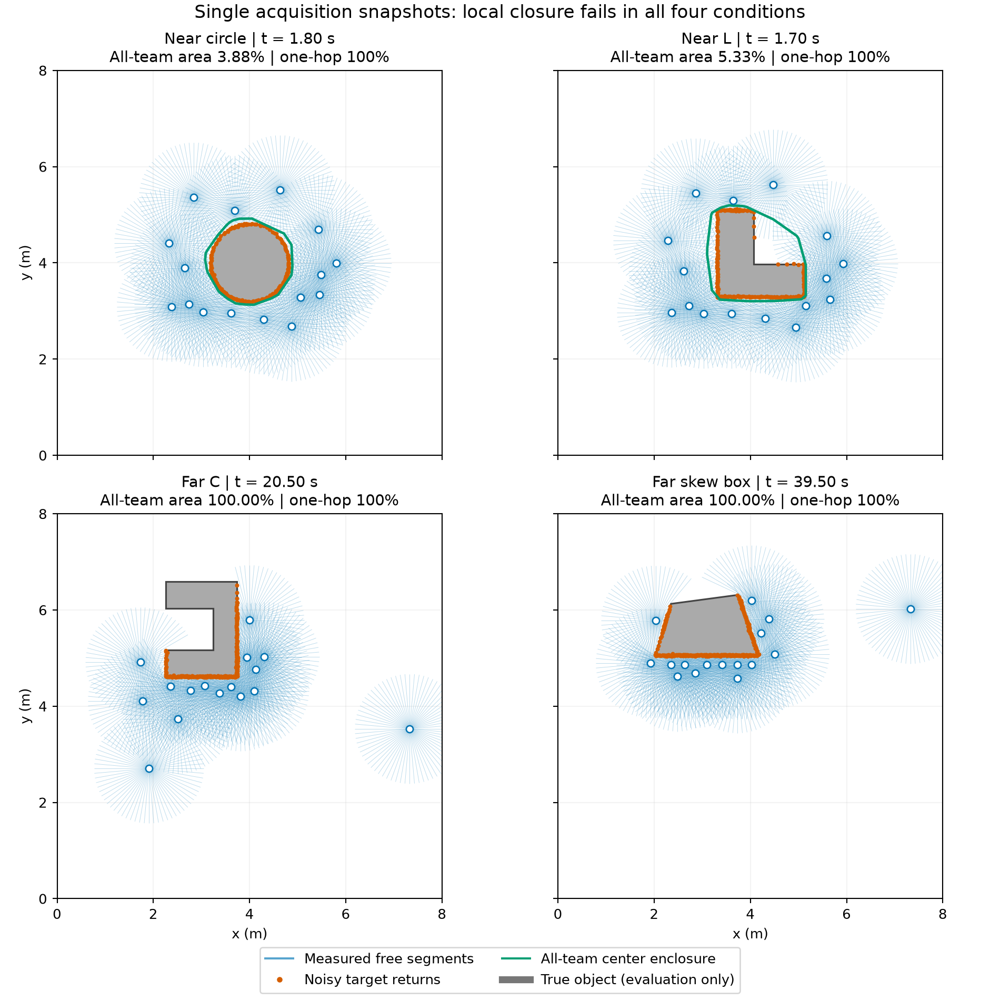

# 自由射线包围诊断：信息缺口仍在，未采用为停止修复

2026-11-03。保持最佳公共配置的全部数值参数。本次新增一个**未接入控制器**的条件几何组件，并对既有初始任务参考试验的四个采集冻结时刻做离线诊断。新增物理回合 **0**，没有新的任务完成或可靠性证据。

## 结果

| 条件 | 采集冻结时刻 / s | 单机能缩小范围 | 一跳能缩小范围 | 全队信息的中心集合面积 / 工作空间面积 | 全队集合下的历史最终停止误差上界 / mm |
| --- | ---: | ---: | ---: | ---: | ---: |
| 近场圆形 | 1.80 | 0/16 | 0/16 | 3.88% | 1904.84 |
| 近场 L 形 | 1.70 | 0/16 | 0/16 | 5.33% | 27.44 |
| 远场 C 背向 | 20.50 | 0/16 | 0/16 | 100% | 262.56 |
| 远场斜箱 | 39.50 | 0/16 | 0/16 | 100% | 181.02 |

全队信息是**评估者信息上界**，不是已经实现的一跳或多跳控制器。上界依赖原拟合刚体变换正确；它不是注册误差证书。L 形原回合已经完成，其余三个原回合仍在 BRAKE，表格不将反事实读出重标为任务成功。

全部 **132** 份集合（64 单机、64 一跳、4 全队）都包含完整真实物体和真实面积中心，评估中没有自由线段穿入物体。**128/128 局部集合均未收缩**；其中单机 3 份、一跳 2 份没有目标回波，按原工作空间回退并计入分母。高斯噪声无确定有限上界，四个复用场景的包含性不能替代无条件安全证明。

在原轨迹的 **16,687** 个基本停止候选帧中，替换中心集合后新增“上界通过且投票数足够”的帧仍为 **0**。圆形即使使用全队集合，候选帧的最小上界仍为 **164.03 mm**，超过既有 **120 mm** 任务容差；最终上界从 11.31 m 降至 1.90 m，仍不能处理虚假旋转。斜箱唯一上界通过的旧帧仍缺少第四个投票者。没有改变 20 mm 名义到达阈值、120 mm 任务容差、四票要求或收定判据。

蓝色圆圈是机器人，蓝线是实际测量射线截短后的自由线段；橙点是带噪目标回波，绿线仅表示全队条件中心包围集。灰色完整物体只作评估叠加，未输入几何组件。图中不把相邻射线之间的扇区当作已知自由空间。[可导出的矢量 PDF](free_ray_snapshots.pdf)。

## 方法与可复现性

组件将测量自由线段与已知凸工作空间边界作线段平面划分。若物体连通、位于工作空间内、不与这些线段相交，且每个目标回波误差在既有 **60 mm carve_margin** 内，则物体位于一个与全部回波相容的区域。保留所有相容区域，其并集的凸包包含任意正质量中心；凹形区域也必须取凸包。无目标点、全部区域矛盾或划分失败时，返回原工作空间。此方法不提供未知质量分布、刚体拟合或高斯尾部的额外保证。

原始扫描转换只读取测量距离、射线编号和既有目标标识，方向由传感器标定生成；不读取 `true_normal`、物体中心、顶点、任务起点或仿真姿态。必须传入**完整原始扫描**，不能将置信度筛选后的缺失点当成无回波。其他物体的命中也截断自由线段。

冻结前核验原协议、环境、四份结果收据、全部原始产品和源码快照。重建采用控制计算前的 `times[k]`/姿态，逐项核验 **64/64** 个原始自身扫描计数，四例原采集期均为零接触、零平移、零旋转。16,687 个候选帧及最终帧的旧工作空间误差上界均由诊断字段重新计算并与旧记录一致。

- [冻结协议](protocol.json)、[完整指标与产品哈希](analysis.json)、[绘图来源](figure_receipt.json)。
- 执行源哈希：`6892bbbd247118891622c46ed0c112ffe31714b17435af730b6f246089475112`。
- 原始诊断、清理后的扫描和源码快照：`runs/research/2026-11-03-free-ray-enclosure-v1/`。
- 核心组件：`src/dbact/sensing/free_space.py`；执行器：`scripts/audit_free_ray_enclosure.py`。
- 单工作进程、单内部线程，冻结预算 1800 s，实际 147.38 s。环境身份原样保存在协议中，未安装或升级依赖。
- [工程核验](engineering_checks.json)：18 项新组件测试、39 项相关回归通过；完整核心测试 872 通过、2 跳过。提交后的仓库健康检查通过，独立审查未发现需要修复的问题。工程检查不替代研究采用条件。

四例均为反复使用的开发条件，不能作为独立泛化样本。自由射线子集的一次快照失败，不等于所有历史扫描、所有主动观测策略或所有形状都无法建立包围。

## 下一步判断

1. **先解决采集质量，再冻结任务参考。** 远场两个快照在全队信息下仍无包围，说明单纯转发当前数据不足；先核验采集期历史观测，再设计保持无接触的补观测动作。不能把“已有四个可拟合模板”直接等同于“目标相关几何已充分观测”。
2. **分别处理通信覆盖和观测覆盖。** 对现有冻结图的描述性检查显示，两例近场通信图连通、直径为四跳；两例远场均有一个 15 机器人分量和一个孤立机器人。这里只计算图结构，未执行消息转发；后续应显式测试时间戳、邻接链路、去重和断连，不把全队合并冒充局部执行。
3. **另做目标相关可观测性试验。** 圆形表明，缩小中心集合仍不足以消除伪旋转。下一候选应检验直接任务位移/目标对齐残差能否在保持已有参数的情况下减少这类歧义，同时单列真实旋转带来的模型失配，先离线筛选再做完整闭环。
4. 公共搬运链通过原失败与成功条件后，再冻结新条件和部署方法匹配对照。可靠停止、动态安全、独立部署贡献和 CCTA2027 初稿仍是完整目标的未完成项。

本次结论：**组件可作为条件几何诊断保留；当前单快照方案不进入运行控制，也不作为远场停止问题的修复。**
