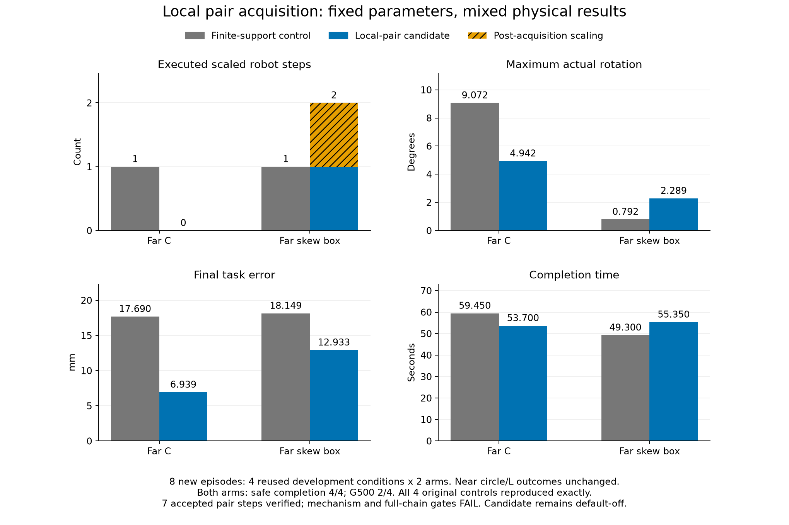

# 静止采集局部配对：完整八回合结果

2026-11-03。新机制已接入控制器并完成独立冻结的 **4 条件 × 2 臂 = 8 个新物理回合**。最佳数值参数、初态、物理模型和原验收门槛全部保持。**C 形改善，斜箱发生回退；机制门槛与完整门槛均 FAIL，候选不采用、默认关闭。** 四个条件已用于机制开发，不能作为未使用条件的泛化验证。

## 完整结果与指标

对照为修正后的有限支持方法 `finite_acquisition_support`；新候选 `local_pair_candidate` 仅开启 `acquisition_pair_safety=True`。全部八回合安全完成，错误 HOLD、原硬安全违规、预算截尾均为 0；两臂的原 G500 均为 **2/4**。安全完成、G500 和正式 TRANSPORT 是不同指标，必须分别报告。完整精度及每例 G500 失败原因为 [all_eight.csv](all_eight.csv)，全部分析为 [analysis.json](analysis.json)。

| 条件 | 方法 | 完成时间 s | 终点误差 mm | 最大真实转角 ° | 采集缩放机器人步 | 采集结束后缩放机器人步 | 正式 TRANSPORT | G500 |
| --- | --- | ---: | ---: | ---: | ---: | ---: | --- | --- |
| 近场圆形 | 有限支持对照 | 16.60 | 18.599 | 0.000 | 0 | 0 | 是 | PASS |
| 近场圆形 | 局部配对候选 | 16.60 | 18.599 | 0.000 | 0 | 0 | 是 | PASS |
| 近场 L 形 | 有限支持对照 | 13.25 | 23.115 | 1.947 | 0 | 0 | 是 | PASS |
| 近场 L 形 | 局部配对候选 | 13.25 | 23.115 | 1.947 | 0 | 0 | 是 | PASS |
| 远场 C 形 | 有限支持对照 | 59.45 | 17.690 | 9.072 | 1 | 0 | 否 | FAIL |
| 远场 C 形 | 局部配对候选 | 53.70 | 6.939 | 4.942 | 0 | 0 | 否 | FAIL |
| 远场斜箱 | 有限支持对照 | 49.30 | 18.149 | 0.792 | 1 | 0 | 是 | FAIL |
| 远场斜箱 | 局部配对候选 | 55.35 | 12.933 | 2.289 | 1 | 1 | 是 | FAIL |

四个新对照均精确复现原有限支持回合的 **25 组回放数组及全部科学字段**，见 [逐例复现证据](original_reproduction.json)。近场圆形、L 形候选的上述物理指标不变。C 形虽相对有限支持对照改善，但仍未正式协作激活；它也尚未恢复更早[观测恢复方法](../reference_reacquisition_physical_v1/README.md)的 1.471° 最大转角、50.45 s 完成时间和 3.748 mm 终点误差，该历史方法另有 13 次采集缩放，不能只选取其中最好的单项指标宣布成功。

预先冻结的 [门槛明细](gates.json)全部保留：机制门槛失败于“候选采集缩放全部为零”和“采集结束后缩放不增加”；完整门槛另要求四条件全部通过原 G500、全部正式进入 TRANSPORT，仍未满足。斜箱最小缩放系数由 0.77734375 降至 **0.1171875**，终点误差改善不能抵消该退化。

## 配对实际执行及剩余事件

新机制在静止采集阶段通过当前一跳消息交换约束、提出配对、分别确认同一指令，然后才执行。只重新分配两机相互避碰责任，保留各自原限速、物体行、墙面行、第三方邻机行和完整裕量。没有获准配对时仍走原安全滤波与统计路径。它假定一步内完成同步消息轮次，尚未验证异步延迟或硬件通信。

本轮共 **7 次获准配对、14 个机器人执行步**，均为 agent_05/09，其中 C 形 4 次、斜箱 3 次。独立审计从回放核对实际指令、裁剪后位置、两方确认、约束残差、各自速度上限及整个保持区间的最小两机间距，全部通过，详见 [完整七次执行表](accepted_pairs.csv)。该表同时记录零起始控制帧和一始保存帧，二者相差 1。审计核对的是收到的观测约束，不能证明未观测物体边界的安全性。

共有 7 次合格的独立问题不可行提案、29 次同帧邻机求解尝试，其中 7 次形成可行配对，另 **22 次是数值求解未验证成功**，不是 22 份数学不可行证明。提案失败与实际执行的缩放分别记账；没有将未执行提案记为缩放，也没有清除实际缩放。

斜箱剩余两个执行缩放的 [原诊断摘录](residual_events.json)为：

- **保存帧 402，ENCLOSE/采集中**：一条有限支持物体行触发可达性截断，`cap_active=1`，因此被预先规定的准入条件拒绝。该帧不属于获准配对失败。
- **保存帧 989，BRAKE/参考已冻结**：已在静止采集范围外，未进入此配对协议。它表明采集期局部修复不能保证后续阶段不再冲突。

下一步先重建帧 402 未截断的约束需求及帧 989 的运动/参考约束，判断冲突是否可由保留原裕量的局部协同解决。另行追踪新 C 形轨迹的推手布局、接触冲量与正式激活；此前有限支持对照的阶段诊断不能直接替代这条新轨迹的分析。取得同一机制的完整四条件验收后，再做更广原成功保持、未使用条件验证、部署方法匹配对照和论文更新。

## 可复现身份与验证范围

- [冻结物理设计](../../../experiments/ccta2027/local_pair_safety_v1_physical_design.md)、[实现设计](../../../experiments/ccta2027/local_pair_safety_v1_design.md)、[协议](../../../experiments/ccta2027/local_pair_safety_v1.json)、[执行记录](../../../experiments/ccta2027/local_pair_safety_v1_plan.md)；更早的实现草案保持原件。
- 物理运行时源码 SHA-256：`6a24d76064d89dbc9485c5f5b3623c4dc7ad2ef187436c32319fe6bf2b782727`。
- 协议 SHA-256：`d991f0ffa0eeceedcdff2a68475a9662fd1b8be258294db5703032b073bd8230`。
- 最佳公共 YAML SHA-256：`a5d5c8e200fa502557d4da9a9db2a646d027abababd59661bcdac21a1b43b112`，与原保护记录一致。
- [工程收据](engineering_checks.json)：冻结前核心 **1033 通过、2 跳过**；随后新增研究辅助/审计测试 **7 通过**，两次独立测试运行分别记账。物理执行 8/8、执行错误 0、源码完整性及全部执行审计通过。工程通过不等于研究门槛通过。
- 本机使用根 `.venv`，Python 3.12.14；原有 joblib/PyYAML 为 1.5.1/6.0.2，与锁文件 1.6.0/6.0.3 的差异如实记录，未更换环境或重标历史数据。
- 原始轨迹、执行前源码和测试快照保留于 `runs/research/2026-11-03-local-pair-safety-v1/`；全部测试失败与通过、执行和发布日志保留于同名 `runs/maintenance/` 目录。大体积原始数据不进入 Git，入口见 [数据索引](../../DATA_INDEX.md)。[publication.json](publication.json)记录九个生成产品及发布脚本的哈希。

局部配对的本轮证据未消除经验支持几何的适用限制，也未解决全队进度聚合和共同阶段监督器的去中心化问题。独立边界部署的完成率优势、未使用条件可靠性、实机表现与当前论文更新仍待完成。
