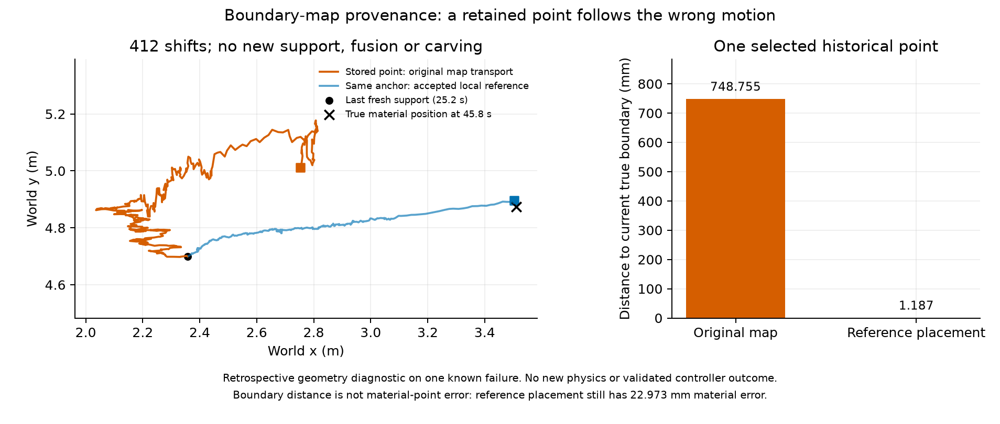

# 安全地图点的来源追踪

**已把一个具体地图失真追溯到历史点的错误运动补偿。** C 形已否决几何候选中，
agent_05 第917帧的最近地图点，在20.6秒内未再获得观测支持，只累计了412次
地图配准平移。其到当前真实边界的距离为748.755mm。此结果解释一个已知失败，
不代表全部953个安全约束冲突都具有同一根因。

本轮新增物理回合 **0**。沿用原采集几何源码、环境、seed和保存的物理输入，
完整重放933帧；每帧的命令、全部诊断、求解统计、阶段/门槛/响应和地图快照
均与原记录精确一致。包装器仅复制内部数组，不改动原计算、RNG或状态。

## 这个点如何偏离边界

从第917帧倒查至最后一次新观测支持的第505帧，逐帧验证：

- 点在注册、重新分配体素、雕刻、融合各阶段的实际位置和键；
- 其祖先始终只有一个，没有体素碰撞、融合或雕刻删除；
- 第505帧位置加全部412个配准平移，重建第917帧位置误差仅4.44e-16m；
- 观测时间始终是25.2s，检查时为45.8s；衰减后置信度仅0.002035，但点仍被保留。

| 指标 | 结果 |
| --- | ---: |
| 历史点累计地图平移 `(x,y)` | `(0.396525, 0.312990)` m |
| 同期真实物体中心位移 | `(1.129788, 0.192816)` m |
| 同期同机任务参考位移变化 | `(1.147066, 0.195551)` m |
| 同期真实转角变化 | 1.349257° |
| 原点到当前真实边界的距离 | 748.755 mm |
| 用任务参考重定位后到当前边界的距离 | 1.187 mm |
| 原点相对对应真实材料点的误差 | 769.489 mm |
| 任务参考重定位后相对材料点的误差 | 22.973 mm |

**1.187mm 是到边界的距离，不是对应材料点的跟踪误差。** 后者仍有22.973mm，
不能据边界贴合就宣称旋转已被正确估计。参考重定位只用于离线解释，未进入
这次原控制器重放，也不是新闭环成功。

## 为什么当前雕刻没有清掉它

保存姿态下重建的原始扫描与已记录点云/法向精确一致：72条射线中仅9条有
回波，9条均通过点云筛选。异常点方向与最近有效回波的角度差为2.754rad，
超过原雕刻孔径0.628rad，所以原“有回波射线”雕刻没有删除它。

离该点方向最近的标定射线编号38，没有回波，角差仅0.0382rad。这说明当前
地图没有利用该方向的无回波信息；但稀疏射线的自由线段不能自动扩张成对任意
未知形状都可靠的自由扇区。本轮没有增加角度容差或以真值删除历史点。

## 修复假设与证据范围

下一项[参考驱动地图候选](../../../experiments/ccta2027/reference_map_v1_design.md)
让地图几何与速度使用同一局部/一跳初始任务参考，避免配准、融合另行累计刚体位移。
缺失参考必须明确记录并停止名义推进；不能取全队真值补齐。它需要另外冻结的
闭环试验验收，且不能单独解决已证明的邻居退让约束矛盾。

[完整祖先分析](ancestry.json) · [全部412次平移](all_412_shifts.csv) ·
[重放身份](trace_identity.json) · [执行结果](trace_outcome.json) · [产品哈希](publication.json)

原始阶段数组和失败预检保存在新目录：
`runs/research/2026-11-03-map-provenance-v1/` 和
`runs/maintenance/2026-11-03-map-provenance-v1/`。
首次预检在第一个控制帧之前因地图尚未惰性初始化而失败，原脚本和说明保留；
调用同一幂等初始化后，第二次20帧预检精确复现，随后完成一次933帧正式重放。

该重放运行源码仍为 `b602d6d64413d897f95e0a2b58914159f9eb97c1c2f6870431aaed3479b5511d`。
公开祖先分析为事后选定点的来源审计，不能计作独立可靠性样本、运行修复采用或部署优势。
