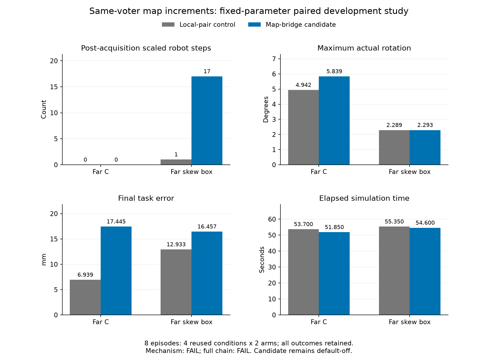

# 地图点源追踪与共同投票者增量：完整结果

**地图跳变的来源已定位，但新候选未通过闭环门槛，保持默认关闭。**
本轮先做989帧精确重放（另列20帧预检），随后冻结并执行四条件×两臂
**8个新物理回合**。全部最佳数值参数、初态、物理模型、限速、安全裕量、
停止判据和600秒预算不变。两臂安全完成均4/4，错误HOLD、原硬安全违规、
预算截尾均0；G500均2/4。原四个对照的25组回放数组及科学字段精确复现。

## 原错误地图点的完整来源

原局部配对斜箱989帧，agent_05使用的地图点位于[2.716227,4.949054]m，
距离真实边界438.753mm，而机器人真实安全余量为+321.326mm。
[逐点祖先](ancestry.json)核验606286次单元坐标比较、191273个图节点；
选中点由17个祖先节点连接到以下三次原始扫描，均来自一跳机器人agent_03。
这三次扫描对最终点的系数之和为1，平移累计贡献为[-.34289245,.00199833]m。

|保存帧|原始点距真实边界/mm|对最终点的系数|
|---|---:|---:|
|976|14.765|0.309307|
|981|10.809|0.349560|
|983|12.045|0.341133|

989帧，投票者由09变为06/09；两者x位移分别为0.183816和1.111963m。
直接使用绝对读数的几何中值，使地图向后跳451.596mm；持续存在的09号
投票者实际只报告向前12.478mm。[原始输入与各步变换](contributing_frames.json)
保留全部证据。这定位了**投票集合变化把读数偏差变成地图运动**的缺陷，
尚未解释上游配准为何接受偏差很大的绝对参考。

## 候选机制和全部物理结果

`reference_map_bridge`默认False。有共同投票者时使用其同一来源相邻位移差
的几何中值；首次移动读数沿用原锚定规则。中断后或完全更换投票集合时，
先丢弃无法相对对齐的目标物历史，再融合当前一跳扫描。其他物体保持原状。
导航/停止投票仍走原参考渠道，控制器不读取物体真值。

|条件|指标|原局部配对对照|共同投票者增量候选|
|---|---|---:|---:|
|近场圆|耗时/s；终点/mm|16.60；18.599|13.70；15.599|
|近场L|耗时/s；终点/mm|13.25；23.115|13.70；17.949|
|近场L|最大转角/°|1.947|1.541|
|远场C|耗时/s；终点/mm|53.70；6.939|51.85；17.445|
|远场C|最大转角/°|4.942|5.839|
|远场C|正式TRANSPORT|未达到|未达到|
|远场斜箱|耗时/s；终点/mm|55.35；12.933|54.60；16.457|
|远场斜箱|最大转角/°|2.289|2.293|
|远场斜箱|采集期/冻结后缩放机器人步|1 / 1|1 / 17|

其余三条件两臂缩放均0。圆形转角两臂均0。完整原精度指标、失败原因、
阶段与审计在[八回合CSV](all_eight.csv)和[分析原件的发布副本](analysis.json)。
每个条件仅一个复用开发种子；机器人步不是独立重复，未声称总体显著性或可靠率。

**机制门槛FAIL，完整门槛FAIL；候选未采用。** 共同来源增量的逻辑测试
成立，但它未改善完整任务的约束表现。斜箱冻结后缩放1→17，C形旋转及
两远场终点误差回退；不能只按略短的完成时间宣布改进。
[全部预定门槛](gates.json)、[四个原对照精确复现](original_reproduction.json)。

四候选共42832个机器人步的桥接状态、当前消息成员、共同来源及位移算术
均核验通过。C形有5次历史重锚定，其他三候选没有；斜箱新增17次缩放
均发生在连续桥接状态，不能归因于历史清空。历史丢弃数量是运行时记录，
对象隔离和丢弃行为由回归测试验证；这不是未知几何安全证明。

## 新回退的事后筛查与下一步

[全部18个缩放状态](residual_screen.json)含原采集402帧事件和新增的17个
冻结后事件，新增物理/重放均0；这是事后筛查，不修改预定门槛。
17个事件全部是agent_14，发生于469–517帧：ENCLOSE15次，CONTACT_READY2次。
当时真实边界距离159.829–185.857mm，地图位移误差仅0.925–5.125mm。
这不支持把新增冲突直接解释为数十厘米地图跳变；具体安全行和邻机联合
约束尚未重建，边界平面外推、法向与邻机约束均需检验。

下一步优先按新冻结源精确重放这18个状态，保存全部原始扫描、选中有限
边段/投影位置、物体行和邻机行，分别检查几何误差与联合不可行性。
只在同状态证据区分原因后修改约束生成，保持原限速/裕量；随后重新冻结
配对物理试验。另需解决C形制动前推手不足及正式激活缺失，上游参考偏差
也仍未解决。边界部署独立贡献、跨形状/多种子验证、完全局部分布式阶段
控制、异步/硬件与最终CCTA2027论文证据尚未完成。

## 复现与工程证据

[独立审查](final_review.md)未发现Critical/Important/Minor；另独立运行10项
新测试全部通过。审查支持保留默认关闭的实验及负面结果，不批准默认采用。

- [机制与物理设计](../../../experiments/ccta2027/map_reference_bridge_v1_design.md)、
  [冻结协议](../../../experiments/ccta2027/map_reference_bridge_v1.json)、
  [执行记录](../../../experiments/ccta2027/map_ancestry_v1_plan.md)。
- 核心1055通过/2跳过，151.13秒；针对性33通过、另2个门槛测试通过。
  [工程收据](engineering_checks.json)保留数值配置SHA、环境及冻结源。
- 首轮核心983通过/2跳过、68个临时目录错误、2个新增默认开关的基线比较
  失败被完整保留；新临时目录及显式False断言后的完整运行才是上述通过证据。
- 运行时源`de7e895a4a74c44b39bc4395ca800d73b9579c9452c96da67fe3e6fcca3d5432`；
  最佳YAML仍为`a5d5c8e200fa502557d4da9a9db2a646d027abababd59661bcdac21a1b43b112`。
  Python3.12.14；当前joblib1.5.1/PyYAML6.0.2与锁定1.6.0/6.0.3的既有差异保留。
- 物理原件：`runs/research/2026-11-03-map-reference-bridge-v1/`；
  原轨迹点源重放：`runs/research/2026-11-03-map-ancestry-v1/`；
  工程原件：`runs/maintenance/2026-11-03-map-ancestry-v1/`。均未重标旧结果。
- 旧点源重放的运行时源为6a24d760..，与新物理源不同。重放工具及原计划
  已在其输出目录冻结；复现必须用相应旧源/测试快照，通过哈希检查，不可
  将当前桥接代码作为旧重放结果的来源。
- [发布清单](publication.json)绑定9个生成产品；事后筛查以
  [独立收据](residual_screen_receipt.json)绑定，不改写原清单。
