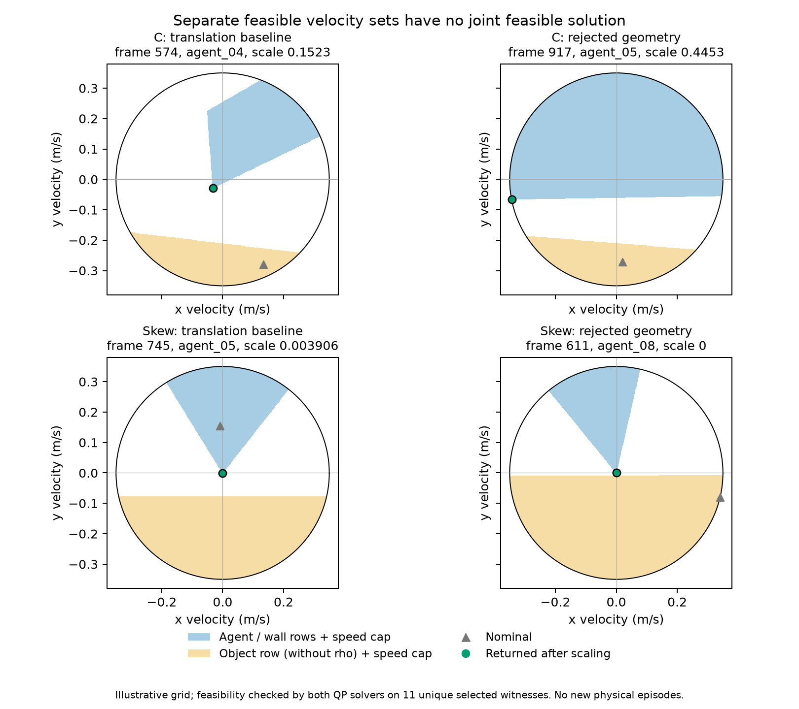

# 联合安全约束诊断：完整重放与可行性见证

**确认了两类问题：局部机器人约束与物体退让要求互相冲突，以及安全地图中
存在与当前真实边界明显不一致的点。** 这是一项定位结果，尚不是运行修复。
仅修改名义目标、去掉裕量或忽略估计速度都不足以解决全部问题。

本轮新增物理回合 **0**，运行代码、最佳数值参数和安全判据均未改变。
使用[上一轮采集几何试验](../acquisition_geometry_v1/README.md)的四条远场
已有轨迹（C/斜箱各两臂），截取到最后一个缩放帧，共 **3,411 个控制帧、
953 个缩放机器人步**。它们是开发数据上的诊断，不是独立泛化样本。

## 重放有效性

用原冻结源码、seed、配置、原环境重放完整控制器，将保存的物体姿态仅输入
原模拟传感器；控制器没有读取真实边界、真实速度或真实物体位移。
每帧的全部命令、记录的诊断字段、求解统计、阶段/门槛/响应和打包地图点均精确
匹配原轨迹。四条前缀全部通过；没有新增动力学步，没有用近似误差代替一致性。

最初短预检因原日志的非有限数值被序列化成 `null` 而失败。修正比较时的
序列化规则后，第二次 20 帧预检通过；两次记录及第一版脚本均保留。
随后另行冻结[协议](protocol.json)、[设计](../../../experiments/ccta2027/qp_conflict_v1_design.md)
和最终脚本，完成一次四前缀诊断。

## 全部缩放步的约束检查

下表数字均为“可行机器人步数 / 本条件全部缩放机器人步数”。硬约束指
机器人/墙约束（本配置没有墙行），所有有速度上限的检查均保留原 0.35 m/s。
“速度置零”在**去掉 rho 的联合约束**上仅将估计物体/边界点速度设为零，
其余几何、邻居、速度上限不变；它只用于诊断，不用于控制。

| 条件与已有臂 | 重放帧数 | 原联合约束 | 去 rho 后 | 仅硬约束 | 仅物体约束、去 rho | 速度置零后 |
| --- | ---: | ---: | ---: | ---: | ---: | ---: |
| C：平移参照 | 579 | 0/8 | 0/8 | 8/8 | 8/8 | 2/8 |
| C：已否决几何候选 | 933 | 0/16 | 0/16 | 16/16 | 16/16 | 2/16 |
| 斜箱：平移参照 | 784 | 0/240 | 0/240 | 240/240 | 240/240 | 66/240 |
| 斜箱：已否决几何候选 | 1115 | 0/689 | 0/689 | 689/689 | 689/689 | 135/689 |

953 步的两个约束子集分别可行，但联合不可行。速度置零只解除 **205/953**，
仍有 **748/953** 不可行。因此不能把问题全归因于速度估计噪声，或通过删除
物体约束、降低安全要求来宣布修复。

这些全量分类由原二维求解器计算。另按执行前规定选取每阶段的首次与最严重
缩放，得到 12 个标签、**11 个不同的帧—机器人见证**；CVXPY/CLARABEL 对五类
可行性的判断全部一致，保存了返回状态、残差和速度检查。

[四条件 CSV](four_cases.csv) · [全部 953 步 CSV](all_scaled_robot_steps.csv) ·
[完整分析及矩阵](analysis.json) · [代数见证](linear_witnesses.json) ·
[执行记录](execution_outcome.json) · [产品哈希](publication.json)

## 两个有区别的机制

**斜箱：局部退让被邻居约束挡住。** 平移参照第 745 帧 agent_05 的最严重
缩放因子为 0.00390625。与 agent_01、agent_03 的两条约束及一条物体约束
即可组成矛盾：存在非负权重，使 `lambda.T A` 的最大残差为 4.02e-17，
而 `lambda.T b = 0.0187047 > 0`。所以即使取消速度上限，这三条线性不等式
也不可能同时成立。这是给定局部约束的浮点数值见证，不是全团队协作运动
也不可能的证明。

后验线性规划为 9 个不同见证（10 个标签）都找到了这类矛盾组合；这些组合
与独立无速度上限的求解结果一致。两个 C 几何候选见证没有线性矛盾，去掉
速度限制后的最小所需速度分别为 **0.631、1.529 m/s**，超过原 0.35 m/s。
不能据这两个帧就调大速度，也不能说所有冲突都是速度不足。

斜箱参照的 235/240 个缩放步、几何候选的 608/689 个缩放步，真实距离低于
采集安全半径 0.195 m；这不是物体穿透判据。原回合仍满足原硬安全检查并且
采集前无接触，但恢复已受到邻居约束限制。应检查如何在进入这类状态前
协调部署/退让，以及观测误差如何触发它。

**C 形：安全地图的边界失真不能忽略。** 几何候选全部 16 个 BRAKE 缩放步，
机器人距真实物体边界 **0.621–0.870 m**，却由地图构造出负的边界裕量。
第 917 帧 agent_05 距真实边界 0.669656 m，最近地图点只距它 0.079604 m。
由距离三角不等式，该地图点距任何真实边界至少 **0.590052 m**。
这直接证明该时刻地图位置与真实边界不一致；具体由历史观测保留、运动补偿
还是融合过程产生，仍需沿来源追踪，不能只凭这一见证指定单一代码根因。
上述真值仅用于离线评价。

## 下一步与边界

优先追踪安全地图的运动参考及观测有效性：导航已采用不可变初始任务参考，
安全行仍从持续融合的边界地图取得位置、法向和速度。应验证这两个参考是否
一致，并检验陈旧点是否有当前自机/一跳观测支持。明确来源后再实现一个
默认关闭的共同参考或观测有效性修复，保持全部最佳数值参数。

对真实处于采集裕量内的斜箱机器人，还需单独处理邻域协作退让的可行性；
局部硬约束的矛盾不授权放松安全行。每项修复都须保住现有四例完成并减少
分阶段缩放，再开展更广的原成功保持和未用条件验证。

本轮没有新任务成功率、控制候选采用、普遍安全证书或部署优越性结论。
全系统去中心化、旋转适用范围、锁环境物理复现、独立部署贡献及论文更新
仍是未完成的研究目标。此前各轮的失败和全部数值参数保持原状。

原始矩阵/完整前缀重放保存在 `runs/research/2026-11-03-qp-conflict-v1/`；
预检及工程日志在 `runs/maintenance/2026-11-03-qp-conflict-v1/`。
运行源码指纹仍为 `b602d6d64413d897f95e0a2b58914159f9eb97c1c2f6870431aaed3479b5511d`，
沿用上一轮已核验的 892 通过/2 跳过运行代码，本轮未因分析脚本重复完整物理或核心测试。
协议 SHA-256 为 `7422c188312484b0ca663851e1910e01d0f04cc052aa65a2148e98f8d614c318`。
