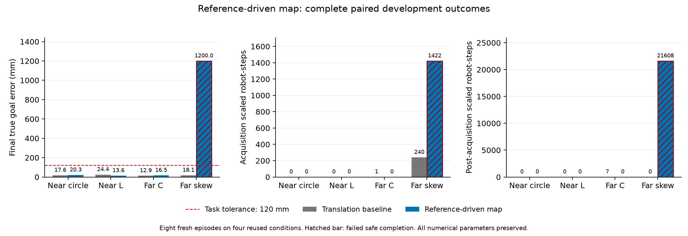

# 参考驱动地图：完整八回合验证

**预定门槛 FAIL，候选未采用，默认关闭。** 安全完成从原参照4/4降至3/4；
G500仍为2/4。C形的8次屏障缩放降为0，但斜箱未能冻结初始参考，600秒结束时
仍距目标1.2m，出现23,030个缩放机器人步。全部失败和预算截尾保留。

本轮新增物理回合 **8**，四个复用开发条件×原平移参照/参考地图候选。
最佳数值参数、物理设置、阶段门槛、成功/硬安全/G500判据及600秒预算不变。
前一轮已否决的采集几何开关保持关闭，没有按形状拼接候选。

## 改动与验收

新增默认关闭的 `initial_reference_map_motion`：采集期间沿用既有静止零时刻假设；
冻结后用同机及当前一跳邻居的新鲜任务参考，驱动地图历史点的平移和速度。
自身扫描配准保留诊断，但不再移动地图；融合不再累计第二份刚体位移。

局部缺少新鲜参考时，保留并老化最后有参考的历史地图，不将未配准的移动观测
混入其中；当前安全视图只暴露新鲜本机/一跳点云，名义速度归零，物体行使用
既有速度先验界。**名义速度归零不表示安全QP输出也为零，更不表示联合约束可行。**
本次斜箱截止后的21,608次缩放就是该退化策略尚未满足目标的直接证据。

四个原参照全部25组回放数组及配置、诊断、物理子步、科学汇总字段精确复现。
八回合执行错误0、源码完整性PASS；两臂错误HOLD和原硬安全违规均为0。
这些结果不能抹去约束缩放、采集失败或任务截尾，也不是总体可靠率。

| 条件 | 终点误差 mm，参照→候选 | 用时 s，参照→候选 | 采集期缩放，参照→候选 | 采集结束后缩放，参照→候选 |
| --- | ---: | ---: | ---: | ---: |
| 近场圆形 | 17.601→20.323 | 14.70→17.00 | 0→0 | 0→0 |
| 近场L形 | 24.398→13.580 | 17.65→18.45 | 0→0 | 0→0 |
| 远场C形 | 12.925→16.482 | 43.60→45.20 | 1→0 | 7→0 |
| 远场斜箱 | 18.126→1200.000 | 52.25→600.00（截尾） | 240→1422 | 0→21608 |

“采集结束后”包括失败后进入 `unavailable` 的阶段，**不表示成功冻结**。
斜箱候选的21,608次全部发生在 `unavailable`；其参考不可用机器人步为172,800。
C形候选有494个参考不可用机器人步。全部候选缺测步均核验名义速度为零，全部
有效参考投票均来自同帧已接受的本机/一跳读数。机器人步不是独立样本数量。

G500：圆形/L形两臂均通过；C形/斜箱两臂均未通过。候选只有3个有效零时刻。
预定“4例安全完成且零时刻有效”、“采集缩放为0”、“逐条件采集结束后缩放
不增加”三项门槛失败。

## 两项具体遗留问题

**斜箱的安全采集仍不成立。** 首次候选缩放出现在第365帧、DISCOVER阶段。
第1200帧仍在采集，第1201帧因原60秒截止进入不可用；最终12000帧未发生物体
位移。下一步需检查机器人能否在原间距和非接触条件下，取得足够方向的局部
边界观测，并形成可行的邻域部署/退让。不能先降低安全半径、放宽参考准入或
延长截止，再宣称修复。

**C形的协作激活门槛没有达到。** CONTACT_READY持续240帧，激活数为0/1/2/3的
帧数分别为19/167/45/9，始终未达到原4台门槛；随后因估计制动条件直接进入BRAKE。
因此实际搬运完成且缩放为0，G500仍报告TRANSPORT未激活。应改善接触与参与分配，
不能伪造阶段记录或降低激活门槛。候选C形真实最大转角为3.1505°，L形为1.0323°；
平移模型仍不构成旋转可靠性证书。

[历史点来源追踪](../map_provenance_v1/README.md)说明为什么值得修正地图运动，
本次负结果说明该修正尚不能直接采用。原平移参照、否决的几何候选和全部参数保持。
后续先处理采集观测、联合退让和协作激活，再进行更广原成功保持、未用条件验证，
之后评价边界部署的独立贡献及更新论文。完整目标仍未完成。

[全部八回合CSV](all_eight_episodes.csv) · [完整分析及门槛](analysis.json) ·
[冻结协议](protocol.json) · [执行结果](execution_outcome.json) ·
[物理源码对应工程检查](engineering_checks.json) · [产品哈希](publication.json)

物理运行源码：`dc9e9ac1d5360f54c4bc7b85d1066c8ec01b1baa8955d90c181385857b918f37`。
协议SHA-256：`7f61ac1b581c4d1b0b9b908791f839bd02f622297a68fbbdd4cd4798fcc7648d`。
运行前核心回归903通过/2跳过，针对性71通过。原始结果在
`runs/research/2026-11-03-reference-map-v1/run/`，执行前源码/脚本在同级`freeze/`；
工程和后验诊断在`runs/maintenance/2026-11-03-reference-map-v1/`。
本地joblib/PyYAML与锁文件的既有差异仍存在，不能标记为锁环境物理复跑。

发布前的[独立最终审查与收尾](final_review.md)发现并修复了一项配置兼容问题：
参考地图候选现在拒绝会忽略逐点缺测速度界的 `nearest_feature` 约束模式。
八回合均使用聚合模式，冻结结果保持原源码身份；后续构造防护的源码与回归
另存于[修订检查](guard_followup_checks.json)，不表示重新运行了物理试验。
