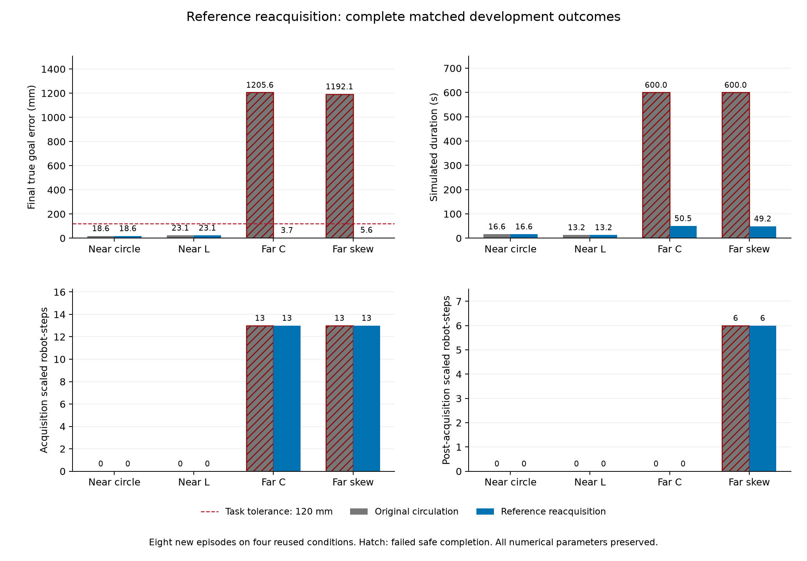

# 观测恢复：八回合闭环验证

2026-11-03，四个已复用的开发条件×两臂，八个新物理回合全部执行完成，执行错误0。
原主动采集与观测恢复候选的安全完成数从 **2/4提升到4/4**，远场600秒截尾从2降为0。
**预先冻结的机制筛选PASS，完整筛选FAIL；候选未采用、默认关闭。**
G500仍为2/4；任务到达和原硬安全检查通过不能代替G500或完整研究目标。

只启用 `reference_map_reacquisition=True`。两臂的种子、初态、全部数值参数、
物理模型、安全QP、成功容差和阶段门槛相同；没有按形状混用候选。
每例最多12,000步、步长0.05秒、预算600秒，原收定要求40帧/0.005速度保持。
最佳配置SHA-256保持
`a5d5c8e200fa502557d4da9a9db2a646d027abababd59661bcdac21a1b43b112`。

| 条件 | 臂 | 安全完成 | 终点误差mm | 仿真时长s | 采集期缩放 | 冻结后缩放 | G500 |
| --- | --- | --- | ---: | ---: | ---: | ---: | --- |
| 近场圆形 | 原主动采集 | 是 | 18.599 | 16.60 | 0 | 0 | PASS |
| 近场圆形 | 观测恢复 | 是 | 18.599 | 16.60 | 0 | 0 | PASS |
| 近场L形 | 原主动采集 | 是 | 23.115 | 13.25 | 0 | 0 | PASS |
| 近场L形 | 观测恢复 | 是 | 23.115 | 13.25 | 0 | 0 | PASS |
| 远场C形 | 原主动采集 | 否，预算截尾 | 1,205.599 | 600.00 | 13 | 0 | FAIL |
| 远场C形 | 观测恢复 | 是 | 3.748 | 50.45 | 13 | 0 | FAIL |
| 远场斜箱 | 原主动采集 | 否，预算截尾 | 1,192.117 | 600.00 | 13 | 6 | FAIL |
| 远场斜箱 | 观测恢复 | 是 | 5.634 | 49.15 | 13 | 6 | FAIL |

两臂错误HOLD均0、原硬安全失败均0；全部八回合保留在分母中。终点误差是独立真实
物体中心到目标的欧氏距离，原容差120mm。时长包含收定并以仿真时间计；600秒项为
预算截尾，不是完成耗时。缩放按机器人步统计，不是碰撞数。
“安全完成”要求原任务完成且原硬安全检查无失败，检查包括机器人间距、进入物体、
穿透预算、求解器回退/失败；它**不要求缩放为零**，所以仍可能G500失败。

[全部八行CSV](all_eight_episodes.csv) · [完整分析与逐帧缩放索引](analysis.json) ·
[PDF图](paired_outcomes.pdf) · [冻结协议](protocol.json) ·
[执行收据](execution_outcome.json) · [发布产品哈希](publication.json)

四个原对照的全部25组回放数组及科学字段精确复现。四个候选直到第一次参考冻结当步
的25组数组及完整控制/物理记录也精确一致；圆/L/C/斜箱冻结帧为47/41/375/409。
候选不会改变此前采集阶段，所以C/斜箱各13次采集缩放完整保留。
全部案例初始零位移参考有效，冻结前物体平移、旋转及接触样本均为零。

冻结的机制筛选要求八例执行完成、四个原对照及四个采集前缀精确一致、四个候选安全
完成且没有错误HOLD/硬失败、保留旧G500通过项、冻结后缩放不增加；这些检查全部通过。
完整筛选在此基础上另要求采集期缩放为零，因此FAIL。原G500也独立保留：C形因未正式
激活TRANSPORT及13次缩放失败，斜箱因19次总缩放失败，没有放宽原合同。

远场C/斜箱分别放行906/870个非零恢复指令，之后各有4台机器人重新获得新鲜参考。
全部投票者都经验证为当前新鲜的自身或一跳邻居。恢复只在初始参考已冻结、局部参考
缺失、阶段早于TRANSPORT、原模式为search/recall/approach且不施加按压力时允许，
仍经过原QP。获得新鲜参考是观察到的后续事件，不是对每个动作的因果证明；
“早于TRANSPORT”也不表示物体尚未发生接触运动。

C形虽然最终误差只有3.748mm，却从CONTACT_READY直接进入BRAKE/HOLD，没有正式
TRANSPORT帧；瞬时最大active计数5不能替代阶段的联合进入条件。斜箱正式TRANSPORT
持续42帧、最大active计数4。下一步需要逐步检查C形接触分工和阶段守卫，不能通过降低
原4台人数要求或其他门槛解决。C/斜箱最大真实转角1.471°/0.843°，本轮没有建立旋转鲁棒性。

[两个采集冲突见证](../circulation_conflict_witness_v1/README.md)是另一次零新增物理回合
的事后诊断。两状态中的机器人都在真实采集安全边距之外，但局部聚合屏障为负；
去掉rho、物体估计运动或速度上限仍有联合矛盾。它支持追踪法向来源、局部支持平面
适用性和邻域避让，只覆盖两个选中状态，不能代表全部26次采集缩放，也不是控制修复。
本次采集前缀精确一致后，可以将这两个冻结前状态关联到本次对应候选。

下一步优先处理采集约束冲突和C形正式激活，保持本次改善、全部最佳参数和原判据。
同一机制通过四条件完整验收后，才进入更广原成功保持、未使用条件验证和部署方法
匹配对照。此前36条既有轨迹只支持CVT覆盖等过程指标改善，尚不支持完成率优势。
全系统去中心化、硬件及论文主张更新也尚未完成。

[工程检查](engineering_checks.json)：938项核心测试通过、2项跳过；新增4项评价器
回归经历RED→GREEN，冻结前另做4个旧评价结果精确检查和4个25数组采集前缀自检。
本轮没有进一步修改运行代码。当前Windows根环境为Python3.12.14；joblib1.5.1/
PyYAML6.0.2与锁文件1.6.0/6.0.3的差异继续保留并披露，不能将这些物理数据称作锁环境复跑。

运行源码SHA-256：`5251bea3bc76971a74f62fc2c7899a33cca52cd57a267cd1feebcd033d8e0eb6`。
协议SHA-256：`b4c04255521da8a72345422e0a65c150c8438abc26c5c55104767b0198b26f0b`。
大体积原始轨迹、源码/脚本/环境快照在本地
`runs/research/2026-11-03-reference-reacquisition-v1/`，工程及执行日志在同名
`runs/maintenance/`目录。原工程检查点、旧失败及原始收据均保留。

[研究设计](../../../experiments/ccta2027/reference_reacquisition_v1_design.md) ·
[执行计划与记录](../../../experiments/ccta2027/reference_reacquisition_physical_v1_plan.md) ·
[冻结与分析脚本](../../../scripts/reference_reacquisition_study.py) ·
[评价器回归](../../../tests/test_reference_reacquisition_study.py)
