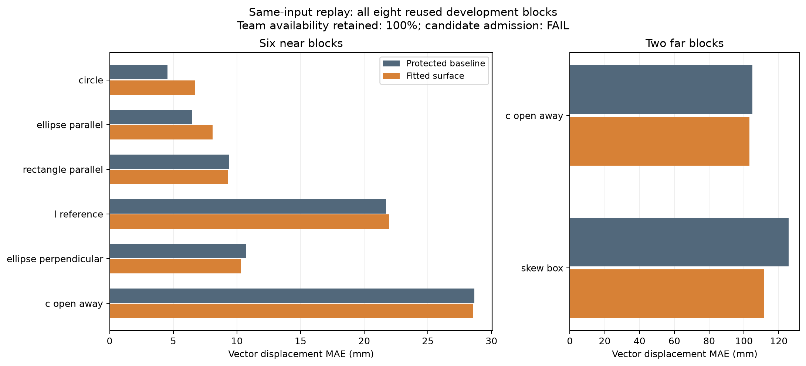

# 保持最优公共参数：参考面拟合试验与基线复现

2026-11-03。**全部既有数值参数保持；新参考面候选未达到事前门槛，未采用。**
本轮完成八条历史轨迹的同输入估计试验，以及一个新执行的完整基线复现回合。
新增候选闭环回合为 0；基线复现使用旧条件，不能计作新增泛化验证。

最终目标仍是利用局部边界观测与邻域通信，对未知形状物体安全部署，完成无附着
协作搬运和可靠停止，并用匹配实验单独证明边界部署的贡献。当前仅做仿真；
现有全队阶段监督器继续明确保留，不声称整个闭环已经完全去中心化。

## 保护的最优公共配置

选择共同 0.45 运动估计先验的配置，而非按物体挑选不同参数。历史证据是旧近场
33/33 安全完成、G500 31/33；后续 12 个初态 11/12 安全完成、G500 9/12，
两批硬安全失败均为 0。这是已测条件下的最佳公共配置，不是全局最优证明。

[完整可运行配置](../../../configs/research/best_known_transport_v1.yaml)以近场 L 形
为示例，将冻结前所有隐式控制器默认值显式保存；其他场景仍由原协议提供。
[参数及来源收据](protected_baseline.json)保存完整值、源码清单、实际环境和 SHA-256。
新增回归检查保护配置的精确字节及全部已解析参数，Git 保留其跨平台字节。

未改变：感知噪声、通信、增益、运动先验、物理接触、时间步长 0.05 s、总预算
600 s、控制到达带 0.02 m、独立任务容差 0.12 m、40 帧/0.005 m/s 停稳规则，
以及原安全和 G500 判据。此前失败的获取/初始参考、创新残差筛选、支撑筛选、
提前初始化和换票连续化候选仍关闭。全局历史默认值也未被替换。

## 本轮八条同输入试验

只改变固定参考模板的局部面表示。使用同一初始自身/一跳扫描，按原 0.12 m
配准邻域、法线相容阈值和 0.03 m 感知残差阈值拟合局部直线；少于八点、残差
过大或方向不相容则保留原点/法线。原初始化时刻、锚点、位移偏置、径向支点、
配准迭代、速度滤波、投票聚合、安全地图和停止逻辑全部保留。

冻结后精确复现了原估计器 **55,845 个状态、54,280 个有效读数**，并核对
81,632 个自身扫描点数；原模板、位移、速度、匹配数量、残差和角度逐项一致。
仿真真值只用于恢复原始传感器输入和事后评分，没有送入候选估计器。

| 已知条件 | 原位移 MAE / mm | 拟合后 / mm | 团队可用率相对原方法 |
| --- | ---: | ---: | ---: |
| 远场 C 背向 | 104.936 | 103.138 | 100% |
| 远场斜箱 | 125.735 | 111.533 | 100% |
| 近场圆形 | 4.539 | 6.698 | 100% |
| 近场椭圆平行 | 6.472 | 8.097 | 100% |
| 近场矩形平行 | 9.408 | 9.293 | 100% |
| 近场 L 形 | 21.720 | 21.935 | 100% |
| 近场椭圆垂直 | 10.723 | 10.298 | 100% |
| 近场 C 背向 | 28.664 | 28.548 | 100% |

MAE 是 CONTACT_READY 后、双方都有新鲜读数的相同帧上，团队位移相对真实中心
位移的二维欧氏误差均值。可用率以原方法有读数的帧数为分母；局部读数数量
可以减少，而团队仍每帧可用。逐帧样本不作为独立实验重复。

预定门槛：每块可用率至少 90%；斜箱 MAE 至少降低 25% 且原错误 HOLD 时刻
仍给出带外新鲜估计；其他七块 MAE 不恶化超过 10 mm。
斜箱实际只改善 **11.30%**，未达 25%；其余门槛通过，总判定 **FAIL**。

原斜箱在 87.25 s 进入错误 HOLD 时，真实目标误差为 135.11 mm，原估计为
18.16 mm；新候选在同一轨迹/时刻估计为 **39.60 mm**，在原 20 mm 控制带外。
这只说明候选在这个固定输入时刻不会满足原位置守卫，不能证明它的闭环将完成。

斜箱局部“大匹配误差”读数从 5,562/19,109 降至 139/12,020。这里“大”沿用
0.12 m 任务容差，对匹配误差做事后分解；分母同时减少，不把计数下降全部解释为
单次拟合变准。团队 MAE 仍有 111.5 mm，说明局部几何清理没有充分解决系统偏差。
圆形和椭圆平行误差还有小幅上升，均如实保留。

[完整八块数据](all_eight_blocks.csv)、[分析和每块判定](analysis.json)、
[设计](../../../experiments/ccta2027/reference_surface_v1_design.md)、
[冻结协议](../../../experiments/ccta2027/reference_surface_v1.json)。

近场和远场使用不同横轴范围；数据来自完整八块 CSV。
[图表数据与文件哈希](figure_manifest_reviewed.json)。初稿图及其收据保留，排版修订不改数据。

## 完整基线复现

保存的近场 L 形配置完成一个新物理回合：19.65 s 完成、终点误差 **8.433 mm**、
G500 通过、硬安全失败 0、屏障缩放 0。最小机器人间距 0.28457 m（原界 0.28 m），
最大穿透 0.05241 m（原预算 0.09594 m），求解器失败/回退均为 0。

全部 25 个 replay 数组与原回合精确一致；逐帧科学字段、物理子步和汇总中的
所有旧科学字段一致。配置由隐式改为显式、执行提交变化导致的身份哈希单独
核验并保留，不删除或伪装成同一次运行。全部解析控制参数、接触参数和阶段门槛相同。
因此本轮保留了此例最优配置的原效果；一个复现回合不能代替全部条件的新验证。

[复现证据与安全指标](baseline_reproduction.json)、
[复现协议](../../../experiments/ccta2027/protected_baseline_v1_reproduction.json)。

## 后续判断与验收指标

本次不进入预留的 24 回合候选闭环比较，不放宽门槛，不组合各候选成功的场景。
继续以保存的最佳公共参数为工作基线。

下一项机制研究应把“任务起点一致”与“实际可观测”一起处理：旧参考仍继承
初始化偏差，材料点的旋转位移仍不等于任务中心位移；此前初始任务参考虽避免
部分错误 HOLD，却因旋转歧义和过宽中心位置界长期停在 BRAKE。
本轮证明局部参考面清理有作用，但单独不足以越过这两类问题。

建议先在已保存的静止获取和搬运观测上，检验带方向/对称性可观测性判断的
初始刚体参考，并用边界与已观测自由空间约束目标相关位置集合；信息不足时
检验主动补观测，而非把无法观测的位移当零或继续加严停止门槛。
这些是待冻结的新机制方案，不是本轮已经验证的改进。

后续主指标仍是：安全完整完成数、错误 HOLD、硬安全失败和预算截尾；辅指标
包括二维终点误差、成功回合耗时、G500 及失败原因、最小间距/穿透预算、约束
缩放和求解失败、估计误差与新鲜反馈可用率。开发验收要求保留原 11 个完成并
救回斜箱，再检查旧 33 条件及未使用初态，不用单项误差下降替代任务完成。

公共搬运链通过后，再在相同参数、初态和感知权限下比较 CVT、spacing、nearest，
独立记录共同时间内的覆盖、最大空缺、部署路径/时间及最终搬运结果。
[现有部署证据](../deployment_contribution_v1/README.md)支持覆盖贡献，三个方法
完成数均 11/12，仍不支持完成率优势。

## 复现与检查

执行源身份：`260f486e31046edbf1f3ff4e1361027c0477b74b6589d0ff55a97c6c28f93e57`。
原始数据、模板和源码快照在本地 `runs/research/2026-11-03-reference-surface-v1/`；
基线复现在 `runs/research/2026-11-03-protected-baseline-reproduction-v1/`。
本轮没有安装依赖；实际 PyYAML 6.0.2 与原锁文件 6.0.3 的既有差异保留。

核心全套 853 项通过、2 项历史跳过；之后新增参数收据保护测试，相关 27 项
全部通过。首次全套尝试因系统临时目录创建失败有 65 个 setup 错误，完整日志
保留；改用新的仓库内临时目录后全套通过，没有为消除错误修改运行代码。
独立代码复核未发现阻断问题。最终工程检查另见 `verification.json`。

入口：[同输入试验脚本](../../../scripts/reference_surface_study.py)、
[基线验证和结果生成](../../../scripts/publish_reference_surface.py)。已完成批次禁止
覆盖或追加成新的试验；输出目录的存在检查和源码/环境/输入哈希检查继续生效。
