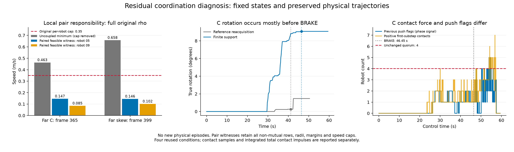

# 两个残余冲突与C形制动前协作诊断

2026-11-03。本轮**新增物理回合0**：使用此前八回合的原始数据，精确重建全部
**5,361帧**阶段响应、核验**21,444个**物理子步，并分解两个已知残余状态。
运行时源码、最佳参数、速度上限、安全半径、原rho、四台门槛和成功标准均未改。
本轮定位了可执行的下一步方向，尚未消除运行中的两个缩放步或C形退化。

## 残余不是取消速度限制后仍存在的线性矛盾

两例的包含意义下最小冲突均由一条物体约束和`agent_05`对`agent_09`的间距约束组成。
逐行删除采用固定顺序，保留集合去掉任一行均恢复可行；不声称它是全局最小行数集合。
机器人约束、物体约束分别在原限速下可行，联合则不可行。

| 保存状态 | 原限速 m/s | 无速度上限时所需最小速度：完整rho / 去rho | 两机间距 m | 高于原最小间距 |
| --- | ---: | ---: | ---: | ---: |
| C，帧365，agent_05 | 0.350 | 0.463310 / 0.383395 | 0.290989 | 10.989 mm |
| 斜箱，帧399，agent_05 | 0.350 | 0.658177 / 0.503573 | 0.288329 | 8.329 mm |

两状态相对真实物体的采集安全余量仍分别为34.351/25.863mm。真实几何仅用于观察诊断，
不能因此删除观测不确定性裕量；缩放也不能直接称为碰撞。
[完整约束表](residual_constraints.csv)及[全部矩阵与独立核验](analysis.json)保留完整rho/去rho两种情况。

## 原限速下，邻机责任重新分配有可行见证

[独立后续设计](../../../experiments/ccta2027/local_pair_feasibility_v1_design.md)固定两状态×两种rho，
核验两台机器人的自身物体、其他邻机、墙和速度约束。
只将这对机器人各自承担一半的相互避碰条件合并为原相对运动条件：

`2(p_i-p_j)·(u_i-u_j) >= -gamma_agent (||p_i-p_j||²-d_min²)`。

其他约束均保留。四个问题均由CLARABEL与独立SLSQP找到可行指令，并逐行检查残差和每台速度。

| 状态 | 完整rho下 agent_05 / agent_09 的见证速度 m/s | 原逐机求解 | 两机联合 |
| --- | ---: | --- | --- |
| C，帧365 | 0.146649 / 0.084820 | agent_05不可行，agent_09可行 | 可行 |
| 斜箱，帧399 | 0.145524 / 0.101962 | agent_05不可行，agent_09可行 | 可行 |

这支持优先实现局部邻机协商，而非提高0.35m/s限速、减小安全半径或删除物体约束。
它只是两个保存状态的存在性见证；**尚未实现消息确认、重叠配对消解或新闭环控制**，
不能当作安全证书、缩放清零或新物理成功。[四个联合问题与全部指令](pair_feasibility.json)。

## C形旋转主要发生在制动前

每一帧的阶段、阶段响应和上一帧推手计数都与原记录一致，没有发现漏掉满足条件的TRANSPORT转换。

| C形指标 | 观测恢复对照 | 有限支持候选 |
| --- | ---: | ---: |
| CONTACT_READY阶段时长 | 16.70 s | 22.70 s |
| 该阶段最多声明推手 | 3 | 2 |
| 该阶段最多正向物理接触 | 3 | 4 |
| 开始BRAKE | 41.25 s | 46.45 s |
| 首次四台推手阶段信号 | 46.05 s | 47.55 s |
| 制动前真实前向位移 | 0.762164 m | 0.768444 m |
| 制动前真实转角 | 0.258435° | 9.065556° |
| 整回合最大绝对转角 | 1.471216° | 9.071854° |
| CONTACT_READY合接触转矩冲量 | 110.137 N·m·s | 316.894 N·m·s |
| 正向接触样本中无push标志 | 132 / 466 | 200 / 615 |

候选在30.00s就曾有四个正向物理接触，但这不等同于四台合格推手；阶段信号首次满足四台门槛，
晚于制动1.10s。候选在制动前已积累9.066°旋转，不能主要归因于停止阶段。
首子步样本中，侧面cage机器人也有明显转矩；这些样本支持进一步追踪覆盖速度的法向分量与初始推手布局，
尚不能将某一机器人或控制分量判为全部旋转的原因。

[全部八回合阶段表](phase_summary.csv) · [逐阶段逐机器人首子步样本](first_sample_contact_distribution.csv)

[PDF图](diagnosis.pdf)。左右方法的运行时长不同，样本数和累计冲量不是统一暴露时长下的发生率。
图示速度是保存状态上的优化结果，后两图仍来自原物理轨迹。

## 采样、失败和工程身份

源代码确认接触模型返回控制步**首个物理子步**的接触报告。每帧的报告合力/转矩均与该子步精确匹配；
逐机器人力矩由同一子步位姿和接触力重建，法向及合力矩与原记录核对。
逐机器人表是样本累加，不是整步冲量；合接触冲量使用全部四个子步积分。
地面摩擦另行作用，累计接触转矩不是最终转角的直接因果解释。

首次attempt1完成诊断但将接触报告误标为末子步，已追加作废说明并保留全部原件。
修正采样口径、增加对应RED/GREEN回归及逐帧匹配后，另行冻结attempt2作为本次依据；没有覆盖旧输出。
第一版图中后制动段七接触峰值超出纵轴，布局v1原件保留；发布版扩大显示范围，科学数据不变。

[工程收据](engineering_checks.json)：核心**1000通过/2跳过**，新增五项回归包含速度冲突、冗余行、
全部子步积分、缺失子步拒绝和首子步报告识别。原始失败和所有日志保留。
[独立发布审查](final_review.md)复算全部阶段、残余分解与四个联合问题；README分母措辞已修正。

- 物理来源仍为[有限支持v2协议](../../../experiments/ccta2027/finite_acquisition_support_v2.json)，
  运行时源码SHA-256仍为`cce9a4fdc1677a54a7faa9ea6d9baf6c5110387b8acee63e158f6da378952177`。
- 最佳配置SHA-256仍为`a5d5c8e200fa502557d4da9a9db2a646d027abababd59661bcdac21a1b43b112`。
- 诊断原件：`runs/research/2026-11-03-residual-coordination-v1/attempt1|attempt2/`。
  联合见证：`runs/research/2026-11-03-local-pair-feasibility-v1/`。
  日志、测试和图布局：`runs/maintenance/2026-11-03-residual-coordination-v1/`。
- [发布哈希](publication.json)对应完整分析、四行约束表、八行阶段表、接触样本表和图表。
  本地依赖与锁文件的既有差异仍按原物理协议披露，没有换环境重标结果。

下一步先按[局部协商实现草案](../../../experiments/ccta2027/local_pair_safety_v1_spec.md)实现与测试消息确认和安全责任分配，
另冻四条件配对物理试验；同时继续区分C形的非推手挤压、推手几何布局和正式激活不足。
完整搬运链、未用条件验证、部署独立贡献、论文和实机目标仍未完成。
