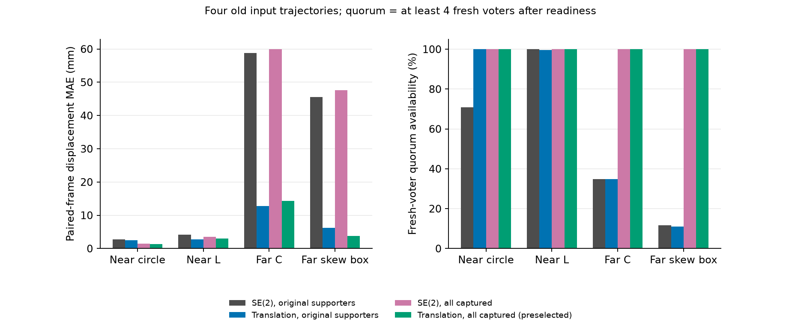

# 四条件平移参考比较：完整数据、原筛选 FAIL

四个固定条件、四个固定估计臂的数据现已完整。**原预选组合的冻结筛选结论为 FAIL；候选未采用，新增物理回合为 0。** 三项完整 v2 输出经哈希核验后复用，缺失的远场斜箱单独补算；所有输入均是旧任务参考物理轨迹。这不是四个新闭环成功，也不是新的泛化验证集。[原 3/4 时间戳快照](../task_translation_checkpoint_v1/README.md)保持原样。

## 结果与指标

预选组合始终是 `translation_all_captured`，不按形状择优。MAE/P95 在原参考与该臂同时有反馈的 CONTACT_READY 后帧计算。四项配对反馈可用率均为 100%，预选组合全部评价帧均有至少四个新鲜投票；“存在团队反馈”和“达到四票要求”分别计数。

| 条件 | 配对帧数 | 原参考 MAE | 预选组合 MAE / P95 | 原参考→组合的四票帧数 | 组合最长有效潜在停止连续段 | 原筛选 |
| --- | ---: | ---: | ---: | ---: | ---: | --- |
| 近场圆形 | 11,899 | 2.687 mm | 1.381 / 2.625 mm | 8,420→11,899 | 824 | PASS |
| 近场 L 形 | 293 | 4.117 mm | 3.062 / 5.898 mm | 293→293 | 17 | FAIL |
| 远场 C 形 | 11,549 | 58.850 mm | 14.270 / 19.041 mm | 4,020→11,549 | 0 | FAIL |
| 远场斜箱 | 11,189 | 45.514 mm | 3.802 / 6.623 mm | 1,296→11,189 | 2 | FAIL |

四项均通过原误差、相对可用率和“真实误差超过 120 mm 时的潜在停止帧为零”检查；L/C/斜箱未达到原 40 连续帧要求。组合的潜在停止帧总数分别为 11,036、38、0、7，不能转记为物理 HOLD 事件或完成回合数。所有四臂、不可用分母、票数不足、RMSE/P95/最大误差和输出来源均见 [16 行 CSV](all_arms.csv) 与 [完整分析](analysis.json)。这些相关帧不用于推断总体可靠概率。

[矢量图](comparison_v2.pdf)。右图分母是各条件的全部 CONTACT_READY 后帧，门槛是至少四个新鲜投票。图只描述旧输入上的变化，没有新闭环样本或统计置信区间。首版图与[原发布收据](publication.json)保留；紧凑排版的[图像收据](figure_v2_receipt.json)只更换长轴标签，不改变数据。

## 两个机制的独立作用

远场 C 形只换平移模型时 MAE 为 12.757 mm，但四票覆盖仍只有 4,017/11,549；只扩大已采集模板准入时四票覆盖达到全部帧，MAE 则为 59.933 mm。斜箱对应两个单独改变的 MAE 为 6.238 mm 和 47.612 mm，组合为 3.802 mm。信息准入与运动模型分别解决投票不足和位移偏差，不能只给出组合结果而省略控制臂。

本次重放的数值参数和产生输入轨迹的控制器保持原样。模板只取原冻结时刻以前自身/当前一跳已采集的观察，没有运动后重新置零。平移模型中的零拟合转角仍是一项假设，不是测得真实零旋转或一个误差证书。[旋转背景核验](../task_translation_rotation_context_v1/README.md)限定了这些旧条件的旋转范围；更大真实旋转和闭环路径变化仍可能造成失配。

## 为何保留 FAIL 后仍需检验真实闭环

[原 L 形停止校准](../task_translation_checkpoint_v1/stop_screen_calibration.json)显示：原成功轨迹进入 HOLD 后有 40 个物理安静帧，原估计器却只有 9 个连续潜在停止帧；组合在这个旧 HOLD 窗口有 38/40 个潜在停止帧，最长连续段为 17。离线连续入场与真实 HOLD 后收定不是同一判据。

[另行标注的事后位置审计](goal_band_audit.json)检查全部四条旧轨迹、整个评价窗口。旧 L/C 的最小真实目标误差分别为 **20.116 / 52.746 mm**，从未进入 20 mm 名义到达带。因此，即使提供完美位置，并忽略速度、票数和模型上界，这两条旧轨迹也没有能够满足停止入场的位置帧。这解释了为什么更准的估计可能要求旧轨迹继续运动，不能把旧轨迹上的不停止直接当作新闭环失败。

这个解释不适用于全部条件：斜箱存在 86 个连续的位置合格帧，而组合的完整潜在停止段最多只有 2 帧。位置审计忽略速度等其余条件，只给出乐观上限；斜箱的完整停止能力仍待实际闭环检验。**所有原 FAIL 原样保留，不事后改门槛。**

[最后控制采样](last_control_sample.json)也保留了差异：C/斜箱的真实剩余误差为 57.674/56.475 mm，组合估计为 44.227/51.110 mm，均要求继续运动。它们是旧轨迹最后一个物理更新前的读数，不能当成新控制器的终点。

下一步拟另行冻结探索性闭环试验，直接比较原最佳配置与同一个平移组合，保持原 600 s 预算、20 mm 控制到达带、120 mm 任务容差及物理收定/安全规则。当前控制代码的向量目标模式在 BRAKE 仍允许正剩余距离下推进，无需先新增阶段回退。该试验回答“能否继续推进并完成停止”，不把本次 FAIL 改成 PASS，也不提前提升默认方法。方案见[尚未执行的闭环草案](../../../experiments/ccta2027/task_translation_physical_pilot_draft.md)。

## 执行身份、异常与完整性

1. 原 v2 在固定 3,600 秒预算耗尽后停止，[原截尾收据](v2_budget_outcome.json)保留。前三项完整输出不重算、不重标为新物理回合。
2. [补全协议](protocol.json)单独冻结 2,700 秒，只补算斜箱。原 v2 `offline_case` 函数、四臂和阈值保持不变。斜箱完整数组及摘要写入后，驱动脚本的路径下标误写导致最终产品哈希汇总退出；[执行失败收据](replay_execution_outcome.json)明确保留为 `POSTPROCESSING_FAILED`。
3. 当前驱动脚本已修正该路径拼接；失败版本仍逐字保存在源码快照。独立[汇总恢复清单](finalization_manifest.json)重新核验四项输入、原始身份和产品哈希，再生成完整分析；估计器更新与物理步数均为 0。没有为了修复汇总而重跑任何轨迹，也没有把失败运行改记为成功。

四条原参考共精确核验 141,429 个局部状态、119,888 个有效局部读数和 35,099 个团队导航读数，并检查 581,968 个单机扫描点数。源代码/环境/快照与产品检查通过，运行源码哈希仍为 `dc425ae9f3e4ee96fbe9290505364c32b0c0a20dbec76b7991ae05f87f5fcaa0`。对应已实现运行代码的[876 通过、2 跳过回归](../task_translation_checkpoint_v1/engineering_checks.json)和已发布 `4e1bb4c` 的[双平台 CI](https://github.com/Wu-kaixin/boundary-aware-cooperative-transport/actions/runs/41512096250)属于工程证据，不代表候选已通过物理验证。

原始 v2、补算和汇总分别位于本地 `runs/research/2026-11-03-task-translation-v2/`、`2026-11-03-task-translation-completion-v1/`、`2026-11-03-task-translation-finalization-v1/`。三个目录及无效 v1 均保留。完整图表是精简公开证据，逐帧原始数组与源码快照不加入 Git。

## 重放完成后的实验接口

发布前的 [MAS 与仓库检查](prepublication_checks.json)为 106 项通过、仓库健康检查 PASS；原冻结快照、12 份原始产品和公开图表哈希重新核验通过。

[独立最终审查](final_review.md)未发现待修项，同意发布本次证据与默认关闭接口；物理性能、泛化和论文完成仍未获验证。

控制器现提供 `initial_reference_motion_model="translation"` 和 `initial_reference_use_all_captured=True` 两个显式选项，均要求启用原初始任务参考；默认仍为 `se2` / `False`。它们只切换运动模型和既有冻结模板准入，保持所有最佳数值参数、原冻结时刻、强支撑者记录及物理/停止判据。没有可用零时刻模板的机器人不能通过后续移动扫描重新初始化；缺失当前观测会撤销当前投票。零拟合转角继续标为假设，不作为真实旋转测量或安全证书。

接口的[本地工程收据](engineering_checks.json)记录 **884 项通过、2 项跳过**，新源码指纹为 `9c7927a57d614f6f2d18757c2677c7af8829203882d3b40effd43043f3afa948`，最佳配置哈希及全部既有参数保持一致。实现前 RED、33 项针对性 GREEN，以及首轮临时目录错误均保留；执行决策见[接线记录](../../../experiments/ccta2027/task_translation_wiring_plan.md)。这是重放数据生成后的新源码，不能将上面的旧源码指纹或离线结果归作该接口的闭环验证；探索性物理试验仍未冻结、未执行。当前本地 joblib / PyYAML 为 1.5.1 / 6.0.2，与锁文件 1.6.0 / 6.0.3 不同，本次没有安装或替换依赖。
