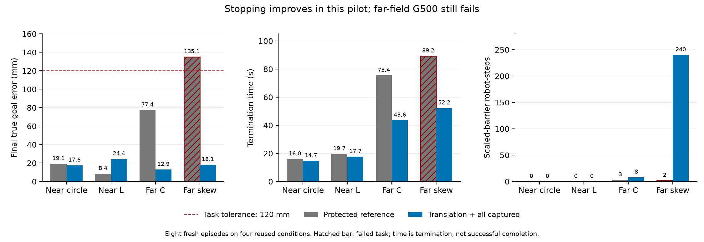

# 平移任务参考的首次闭环比较：4/4 完成，采集安全仍有缺口

固定四条件、两臂，共 **8 个新物理回合**已完成。原最佳公共配置安全完成 **3/4**，平移＋全部已采集模板组合为 **4/4**；错误 HOLD **1→0**，硬安全失败均为 **0**，G500 均为 **2/4**。四个新基线的全部 25 个回放数组和旧科学 JSON 字段均精确复现原运行。所有最佳数值参数、物理、感知、任务及成功/安全判据未改变。

本轮预先冻结的扩展门槛为 **PASS**，只支持继续研究；**候选未采用、默认关闭**。四个条件已反复用于开发，不是任意未知形状的可靠率。前序[同输入重放](../task_translation_completion_v1/README.md)的原筛选 **FAIL 保持不变**：这次回答的是新闭环能否继续推进并收定，并没有改写旧门槛。

## 全部结果

| 条件 | 原配置→候选安全完成 | 终点真实误差（mm） | 终止时间（s） | 屏障缩放机器人步数 | G500（原→新） |
| --- | --- | ---: | ---: | ---: | --- |
| 近场圆形 | 是→是 | 19.148→17.601 | 15.95→14.70 | 0→0 | 通过→通过 |
| 近场 L 形 | 是→是 | 8.433→24.398 | 19.65→17.65 | 0→0 | 通过→通过 |
| 远场 C 形 | 是→是 | 77.409→12.925 | 75.40→43.60 | 3→8 | 失败→失败 |
| 远场斜箱 | 否→是 | 135.106→18.126 | 89.25（失败终止）→52.25 | 2→240 | 失败→失败 |

没有执行错误或 600 秒预算截尾。候选四项零时刻均有效：采集前物体平移、旋转及接触计数均为零；时间计入原预算。全部四项初态/种子一致，候选只有四个机制选择器变化。近场 L 的终点误差变大，虽然仍在原 120 mm 容差内且耗时减少，不能声称所有指标都改善。

[矢量图](paired_outcomes.pdf) · [全部八行指标](all_eight_episodes.csv) · [完整分析、原判据与逐项基线复现](analysis.json) · [冻结协议](protocol.json)。图中的失败时间是实际终止时间，不是完成时间；缩放按机器人步计数，不等于独立失败回合或不同控制帧数。

## 位移参考与停止的证据

斜箱原配置在真实剩余误差 135.106 mm 时进入 HOLD，估计名义误差仅 18.158 mm；候选进入 HOLD 时真实误差 18.126 mm，名义估计 16.204 mm，随后按原规则完成 40 帧物理收定。四项候选均无超过 120 mm 的错误 HOLD。

各自闭环轨迹 CONTACT_READY 后，原配置→候选位移 MAE 为：圆形 **4.571→2.719 mm**，L 形 **21.771→5.170 mm**，C 形 **105.073→14.299 mm**，斜箱 **125.629→7.187 mm**。这些轨迹和窗口长度不同，不能称为同输入逐帧配对误差，也不与前序重放的分母混用。候选分别有 195/195、275/275、423/423、236/236 帧达到四票要求；原分母与缺失帧均在 CSV 中保留。

候选四条件最大真实转角分别为 0°、1.899°、2.574°、0°。这些是独立物理评价读数，不是控制器输入；平移模型的零拟合转角仍是假设。有限小旋转下的四次成功不能证明任意旋转适用性，也不能将条件误差上界当作配准或动态安全证书。

## 首要遗留问题：初始采集阶段的安全约束可行性

[另行标注的事后屏障审计](barrier_diagnostic.json)逐帧核对求解器累计计数与每个机器人的 `scaled_barrier` 状态：

- 斜箱的 **240 次缩放全部发生在 ENCLOSE / acquiring 阶段**，模板冻结和新参考生效前；最小缩放因子为 0.00390625。原最佳公共配置只有 2 次。
- 与早先 SE(2) 初始任务参考的严格冻结前前缀比较，斜箱 **789 个控制帧**的所有检查回放字段、打包扫描点及完整步骤记录精确相同，双方均已发生 240 次缩放。因此这段问题继承自原初始采集机制，不能归因于冻结后采用平移配准。
- C 形候选有 **1 次采集期＋7 次冻结后**缩放；其旧 SE(2) 采集前缀同样精确一致。不能用斜箱的解释替代 C 形冻结后的 7 次问题。

硬安全统计为零只说明这些记录未出现原硬违规；不能覆盖 G500 要求“不缩放屏障”的失败。本轮通过的是明示的完成/误停/硬安全/已有 G500 通过项保持门槛，原门槛没有限制两个原本 G500 失败条件的缩放次数，故仍为 PASS；严重的次要指标退化必须另外处理，不能藏在汇总通过数中。

**下一步优先定位并修复采集阶段的几何/速度估计与安全约束一致性，保持参数和零时刻语义。** 然后扩展到其余受保护条件与未用初态/形状/旋转条件；确认公共搬运链后，再以相同参数和信息权限比较 CVT、spacing、nearest，独立评价部署贡献。完整论文和完全去中心化证据仍未完成。

## 执行与可复现范围

- 本轮运行源码指纹为 `9c7927a57d614f6f2d18757c2677c7af8829203882d3b40effd43043f3afa948`，与已审查接口相同。协议 SHA-256 为 `eb74bd23df060e067f436ade37e921f5ff57e4af404a6264bbf356c706c064e1`。
- 四工作进程、每进程一个数值线程；八回合各最多 12000 步、dt=0.05 s，总步预算最多 96000。实际批次墙钟约 210.4 秒；未增加物理预算、换种子、按形状选择候选或重跑失败。
- [v1 退役记录](superseded_v1_outcome.json)：初版只冻结、未执行物理。在正式运行前发现预算结束标签为 `watchdog`，另冻 v2，按耗尽步数且未收定计截尾。原 v1 设计/协议/脚本快照保持；当前 v1 命令拒绝误启动。修正没有使用任何新候选结果。
- [执行收据](execution_outcome.json)记录 8 个回合、0 个执行错误、源码完整性 PASS；[公开产品清单](publication.json)保留 CSV/图表与分析哈希。原始产品与独立冻结源码在本地 `runs/research/2026-11-03-task-translation-physical-v2/`，不加入 Git。
- 本地实际 joblib/PyYAML 为 1.5.1/6.0.2，锁文件为 1.6.0/6.0.3，已逐包记录在协议中，环境未改变。锁环境的同轨迹物理复现仍需单独检验；CI 通过不替代物理复现。
- [工程检查收据](engineering_checks.json)区分既有 884 项控制代码回归与本轮预检/八回合执行/原始证据检查；本轮仓库检查通过，图像已目视核验，未执行 v1 的原冻结源码仍通过哈希检查。
