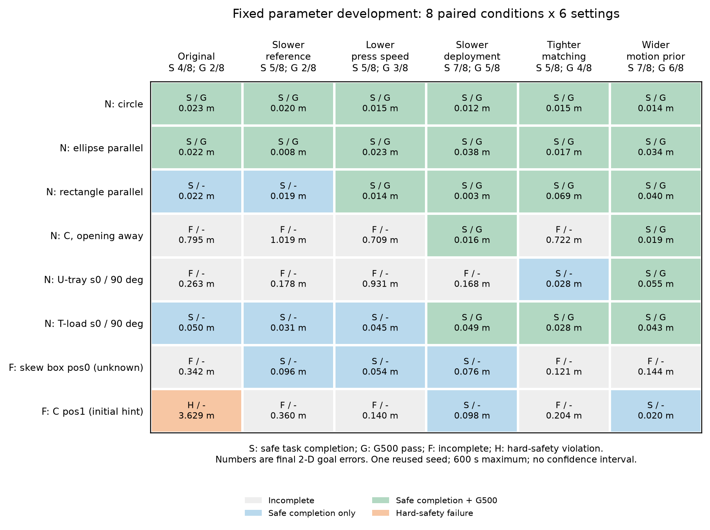
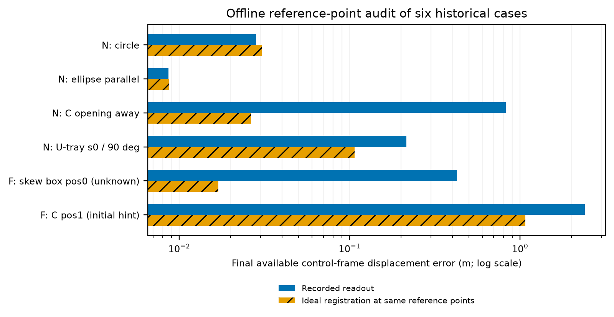

# 可靠运输与G500：固定参数开发结果

本轮参数筛选和后续检查使用同一修复后的控制流程。只做仿真、无附着；原二维到达、停稳、安全和G500判据均保持不变。论文题目未改。

[设计、G500解释与文献对照](../../TRANSPORT_TUNING_RESEARCH_2026-11-02.md)；[筛选协议](../../../experiments/ccta2027/transport_tuning_v1_screen.json)；[执行及分析](../../../scripts/transport_tuning.py)。

## 48回合固定筛选

八个预先选择的开发条件、同一个seed2、每例最多600秒；失败、异常和超时全部进入分母。不能把此比例作为任意形状总体成功概率，也不能从各设置逐例挑选成功后拼成一个算法。

| 设置 | 安全部署到CONTACT_READY | 全流程安全完成 | G500 | 硬安全失败 | 约束缩放总事件 |
| --- | ---: | ---: | ---: | ---: | ---: |
| 原参数 | 8/8 | 4/8 | 2/8 | 1/8 | 740 |
| 降低运输参考速度 | 8/8 | 5/8 | 2/8 | 0/8 | 31 |
| 降低法向压入速度上限 | 8/8 | 5/8 | 3/8 | 0/8 | 37 |
| 降低部署增益 | 8/8 | 7/8 | 5/8 | 0/8 | 32 |
| 收紧配准距离门限 | 8/8 | 5/8 | 4/8 | 0/8 | 33 |
| 提高运动估计速度先验 | 8/8 | 7/8 | 6/8 | 0/8 | 128 |

部署安全统计到第一次CONTACT_READY后的物理帧为止，检查全部已保存机器人状态及既有物理子步、原几何和求解器安全条件。它不是后续运输安全的保证。约束缩放独立报告，不自动等于碰撞。G500与二维任务完成的区别见设计说明。

[完整逐回合表](screen_all_episodes.csv)；[完整筛选分析及原始收据哈希](screen_analysis.json)；[部署与后续安全分开统计](screen_deployment_safety.json)。

八个原参数回合的25个replay数组及原逐帧科学字段均与历史结果精确一致。新的日志开关修复没有改变这些开着诊断的研究运行。预先选择结果：提高运动估计速度先验。

## 24回合迁移检查

按运行前冻结的四个其他开发条件，在CVT、spacing、nearest中同时使用原参数和筛选选中的同一参数。这里不分别替各方法调优，也不改变任何条件的成功判据。选择来自CVT开发集，因此这是共同控制参数的迁移检查，不是各方法最佳调参后的排名，更不是独立验证。

| 部署方法 | 原/候选安全完成 | 原/候选G500 | 原/候选硬安全失败 |
| --- | ---: | ---: | ---: |
| boundary_cvt | 2/4 → 4/4 | 1/4 → 2/4 | 0/4 → 0/4 |
| local_spacing | 2/4 → 3/4 | 2/4 → 1/4 | 0/4 → 0/4 |
| nearest_observed_target | 2/4 → 3/4 | 1/4 → 1/4 | 0/4 → 0/4 |

合计安全完成 6/12 → 10/12；G500 4/12 → 4/12。挽回4个配对完成，丢失0个配对完成，新增0个配对硬安全失败。

保守迁移门槛：PASS。本轮不修改全局默认值；候选及全部失败保留为有版本身份的开发结果。

[全部24回合](transfer_all_episodes.csv)；[迁移分析](transfer_analysis.json)；[协议](../../../experiments/ccta2027/transport_tuning_v1_transfer.json)。

改善并非所有代价都下降。三方法合计约束缩放58→187次；按实际机器人控制步归一化为每1000步0.175→1.073次。分方法看：CVT为24→0次，spacing为25→178次，nearest为9→9次。因此不能把候选称为对所有部署方法都更安全。默认配置保持原状，候选先用于后续冻结的CVT开发/验证。

候选CVT的4个迁移条件均安全完成，但G500仍有两例失败：远场C pos0未记录TRANSPORT激活事件；远场斜箱pos1的严格覆盖峰值0.619未达到0.70。两例都没有约束缩放。安全到达CONTACT_READY、真实推进、任务完成和满足G500过程要求确实不同，不能补写阶段或降低覆盖阈值把这两例改判为通过。

候选在这四个条件上比spacing和nearest各多完成1例，并有更少的约束缩放。这是具体条件内的新支持证据，但条件数小、只有一个开发seed，而且公共参数由CVT筛选，不能据此宣称最佳调参意义上的普遍算法优势。

## 失败机制与论文边界

旧近场C背向、远场斜箱的主要位移误差不能由局部材料点与质心不同来解释，配准残差仍大；旧远场C则在首次越界前已有约0.58米的材料参考点/质心语义误差，即使理想配准也不会消失。参数改变后的闭环轨迹不同，不能仅凭任务改善就宣称这些问题得到一般性解决。

图中橙色是同参考点、同原投票集合的离线刚体运动计算，不是运行过的候选控制器。真值仅用于分析；横轴为对数。完整数字和可追溯哈希见[精简分析](reference_point_summary.json)。

优先的新增对照是：共同运输流程下的CVT/spacing/nearest；边界支撑与检测位置支撑；任务方向偏置消融；非均匀采样下弧长加权消融；冻结参数后的未见初态/几何参数/位置验证。对照必须匹配观测与调参预算，不能以弱接口替换冒充完整文献复现。

现有结果可以支持具体条件下的系统能力和机制分析，尚不能支持“任意形状90%以上可靠成功”“完全去中心化闭环”或“动态接触安全保证”。局部模块仍与公共阶段监督器共存。

工程验证：基线794通过、2历史跳过；修复后795通过、2历史跳过；相关26项检查通过；pip、仓库健康和diff检查通过。未启动实机，没有提交或push。

图的英文caption、数据与生成版本见[图清单](figure_manifest.json)。无平滑、无补造轨迹、无把超时时间当完成时间。
