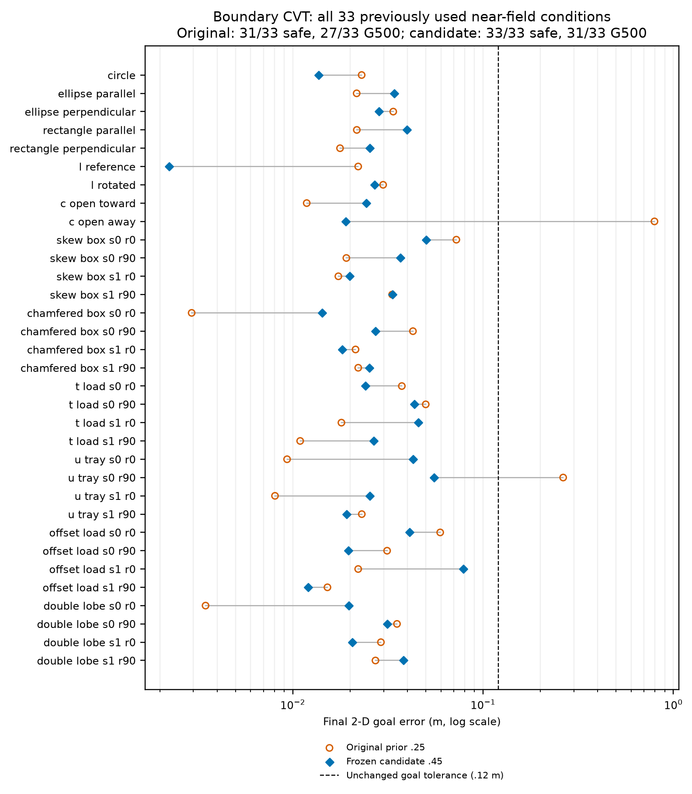
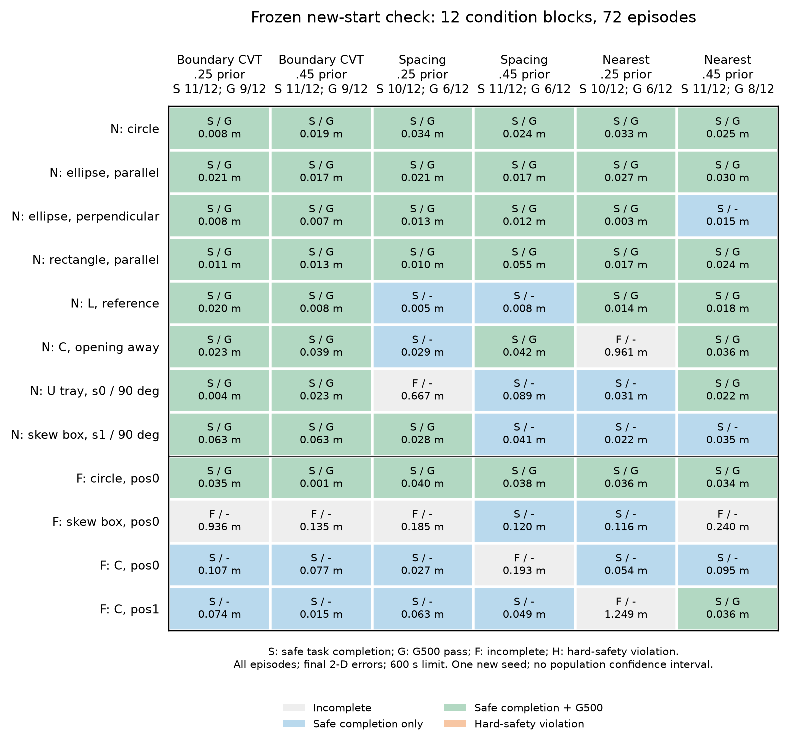

# 运动估计先验：旧条件回归与冻结后新初态检查

本轮固定0.25与0.45两个既定值，没有继续搜索或组合参数。只做无附着仿真，允许信息、物理、时间步长、600秒上限、二维到达/停稳、安全和G500判据均保持。全局默认值和论文题目未变。

## 旧33条件回归

CVT安全完成 **31/33 → 33/33**；G500 **27/33 → 31/33**；硬安全违规两组均为0；约束缩放18→1次。

平均终点误差 0.05607→0.02976 m，但中位数 0.02205→0.02665 m，并非每例误差都下降。两项原任务失败被挽回；G500有6项转好、2项转差。

只补跑缺少的25个候选回合；33个原参数和8个候选回合核验原始产品哈希及配置后复用，明确保留旧执行身份。原源码与现源码只差已审查的关闭trace扫描修复；所有研究入口都开启trace，上一轮8例全科学记录精确复现作为兼容证据。没有把这33个旧初态说成独立验证。

[完整66条比较记录](regression_all_episodes.csv)；[身份、配对与判定](regression_analysis.json)。

## 新初态：12条件×3方法×2参数

运行前固定seed 20261102；近场8条件采用原scatter规则，远场4条件将机器人网格中心移至[3.75,1.05]并加入标准差0.005 m的位置扰动。每个条件六臂初态哈希相同，各条件均与旧初态不同；所有远场初始扫描为空、位置提示为空。圆、两种椭圆方向、矩形、L、C、U托盘及斜箱均在近场或远场检查中覆盖。

这是候选冻结后的新初态检查；几何来自已有开发形状，条件是设计选取且共享随机数，不是任意形状总体的独立同分布抽样。一个新seed不支持一般90%可靠性结论。候选由CVT开发选出，本轮三种方法同参数比较也不是各方法独立充分调参后的排名。

| 部署模块 | 安全完成 原→候选 | G500 原→候选 | 硬安全违规 原→候选 | 缩放事件 原→候选 |
| --- | ---: | ---: | ---: | ---: |
| boundary_cvt | 11/12→11/12 | 9/12→9/12 | 0→0 | 2→5 |
| local_spacing | 10/12→11/12 | 6/12→6/12 | 0→0 | 1→123 |
| nearest_observed_target | 10/12→11/12 | 6/12→8/12 | 0→0 | 70→26 |

| 范围 | 方法 | 原安全完成 | 候选安全完成 | 原G500 | 候选G500 |
| --- | --- | ---: | ---: | ---: | ---: |
| near | boundary_cvt | 8/8 | 8/8 | 8/8 | 8/8 |
| near | local_spacing | 7/8 | 8/8 | 5/8 | 5/8 |
| near | nearest_observed_target | 7/8 | 8/8 | 5/8 | 6/8 |
| far | boundary_cvt | 3/4 | 3/4 | 1/4 | 1/4 |
| far | local_spacing | 3/4 | 3/4 | 1/4 | 1/4 |
| far | nearest_observed_target | 3/4 | 3/4 | 1/4 | 2/4 |

候选三方法均11/12安全完成，完成数优势未成立。CVT的G500为9/12、spacing为6/12、nearest为8/12；缩放事件分别5、123、26次。CVT相对nearest在11/12条件的就绪时未覆盖间隙更小（配对中位差-0.384 m），相对spacing在10/12条件更小（-0.157 m）。这些是本批次的部署与过程质量证据；就绪时刻因方法而异，不是共同物理时刻的覆盖优势，也不是formal caging证明。

参数收益有代价：新初态CVT安全完成11/12→11/12、G500 9/12→9/12，均值终点误差0.10918→0.03465 m，但缩放2→5次；spacing安全完成10/12→11/12，缩放1→123次。spacing与nearest各挽回2个条件、又各丢失1个原成功条件，不能说所有成功都保持。

[全表含全部失败、持续时长和缺失项](new_starts_all_episodes.csv)；[原始收据、配对及计数](new_starts_analysis.json)。失败时间为终止或观察截止时间，不充当成功完成时间。

事前旧条件门槛：PASS；新初态CVT参数改进门槛：FAIL；候选CVT相对两个部署对照均净多完成至少2个条件的门槛：FAIL。不得为通过而改动门槛。

## 原G500保留的失败

G500与安全到达CONTACT_READY、实际接触和最终二维完成分开。下表列出新初态中候选CVT的所有G500失败；其他方法全部原因见CSV。TRANSPORT缺失可能对应阶段机从CONTACT_READY直接制动的合法安全分支，不能补写一个不存在的阶段。

| 条件 | 安全完成 | 终点误差/m | 原G500原因 |
| --- | --- | ---: | --- |
| far_c_open_away_pos0 | True | 0.07741 | G500: transport activation never happened within the 1508-frame run ; G500: 3 scaled-barrier event(s), smallest factor 0.477; the contract allows 0 |
| far_skew_box_s0_r0_pos0 | False | 0.13511 | G500: transport activation never happened within the 1785-frame run ; G500: target reached never happened within the 1785-frame run ; G500: J=1.0651 m stopped 0.1349 m short of L=1.2000 m, outside the declared arrival tolerance 0.1200 m ; G500: 2 scaled-barrier event(s), smallest factor 0.926; the contract allows 0 |
| far_c_open_away_pos1 | True | 0.01481 | G500: transport activation never happened within the 1016-frame run |

旧条件候选的两项G500失败是T-load s0/r0的一次约束缩放（最小因子0.910），以及U-tray s1/r90峰值严格覆盖0.69375<0.70。它们仍完成了实际运输与停止；这没有取消合同失败。

## 停止时实际用了什么估计

[停止事件审计](stop_audit.json)检查全部24个CVT回合及所有未安全完成的对照，按控制前的t[k]对齐真值。逐项保留进入CONTACT_READY、TRANSPORT、BRAKE、HOLD和最后读数时的真实目标误差、实际导航估计与阶段守卫。日志中的旧标量estimated_progress不等于二维导航监督器实际使用的位移，不能拿它替代控制输入诊断。

远场斜箱候选在87.25秒进入HOLD时，导航估计目标误差仅0.01816 m，真实误差却为0.13511 m；最终0.13511 m仍超出0.12 m。它把原参数的0.93612 m大误差显著降低，却没有救回任务。之后物体已停止，局部参考读数与投票集合仍变化；精确向量记账见审计JSON。这支持优先研究停止估计的一致性/偏差及确认逻辑，而非继续延长物理预算。不能仅凭一致性证书宣称估计无偏，也不能把该偏差直接归因于某一个通道。

## 复现、信息权限与结论边界

补充的[首次HOLD进入审计](stop_entry_audit.json)检查了全部24个CVT回合。上述斜箱在进入HOLD的那一帧，物体没有移动；agent_03退出有效投票集合，使团队位移沿运输方向变化-53.08 mm，其中成员移除项为-49.25 mm，共同成员读数变化项为-3.83 mm。估计目标误差从41.33 mm跳至18.16 mm，进入原20 mm控制到达带；阶段机随后锁定HOLD，而真实目标误差仍135.11 mm。这里的20 mm是控制器内部到达带，独立任务容差仍120 mm，没有修改任何门槛。这项精确端点记账支持研究换票时的停止确认，但不能证明历史累计偏差全由换票造成，也不代表固定投票集合的闭环已经验证。[审计生成脚本](../../../scripts/audit_transport_stop_entry.py)。

收尾环境核验补充：本轮开始时实际PyYAML为6.0.2，历史记录和未修改的锁文件为6.0.3。本轮没有安装或变更依赖。41条历史复用记录经当前协议解析器重新解析后，执行载荷的规范SHA与历史resolved_case完全一致；其他已记录环境字段一致。新增97回合均使用同一实际环境。不能把复用记录说成字节相同环境下的新重跑；锁版本差异作为既有环境问题保留，在本地审计的historical_environment_note.json逐项登记。该说明是最终核验补充，不改历史数据或数值结果。

0.45调整的是地图/参考位移估计共用的运动速度先验，不能称为安全速度界放宽；安全对象速度界、原机器人速度与物理参数未改。两通道共同变化，本轮不能单独归因到某一个配准或融合模块。各方法共用自身/一跳观测和既有全队阶段监督，未新增物体真值反馈，不能声称完整闭环完全去中心化。

本轮未改运行源码。旧“材料参考点不等于任务质心”的旋转语义问题仍需与配准误差分开研究；参数改变后的闭环成功不能代替该问题的一般性证明。全局默认保持0.25；0.45仅存在于冻结候选配置。

- [回归协议](../../../experiments/ccta2027/transport_validation_v1_regression.json)
- [新初态协议](../../../experiments/ccta2027/transport_validation_v1_new_starts.json)
- [冻结、运行、环境与恢复保护入口](../../../scripts/validate_transport_prior.py)
- [分析入口](../../../scripts/analyze_transport_validation.py)
- [图表/报告生成入口](../../../scripts/publish_transport_validation.py)
- [图表英文caption及数据哈希](figure_manifest.json)

新原始数据在 `runs/research/2026-11-02-transport-validation-v1/`；完整本地设计/备份/命令/状态在 `artifacts/migrations/2026-11-02-transport-validation-v1/` 与 `runs/maintenance/2026-11-02-transport-validation-v1/`。勿重复冻结、覆盖或把已完成批次追加成新的调参实验。
